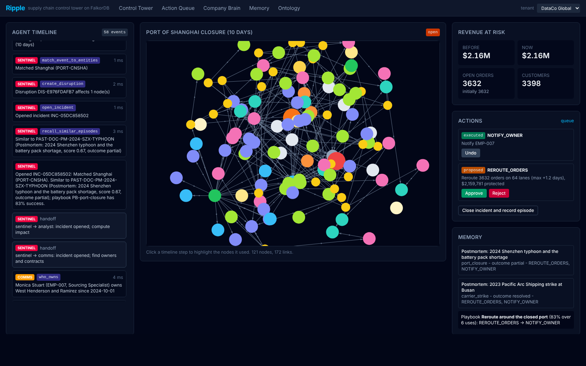
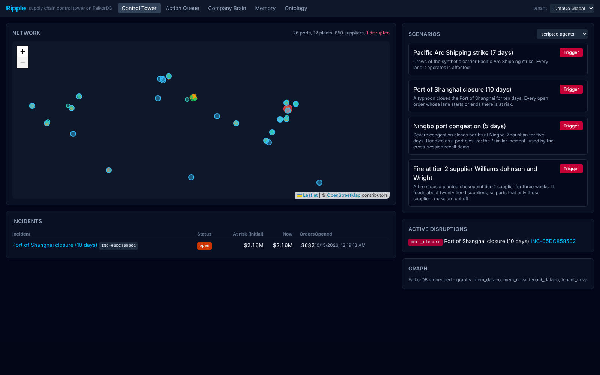
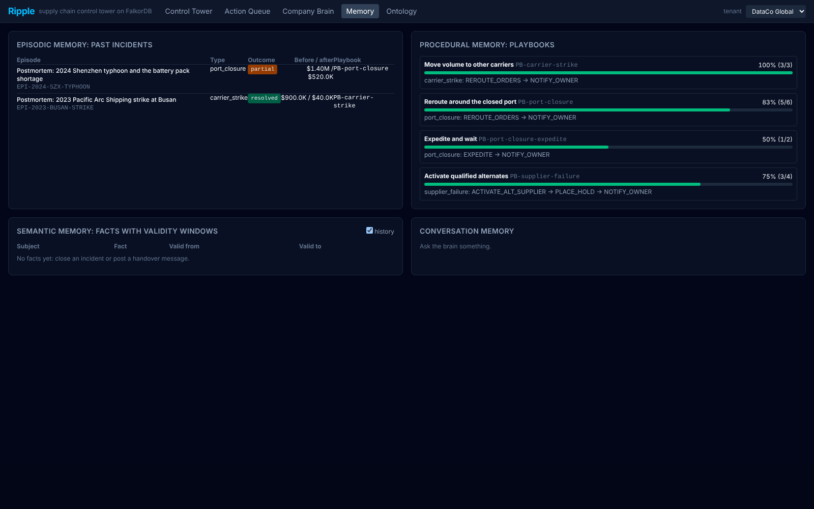
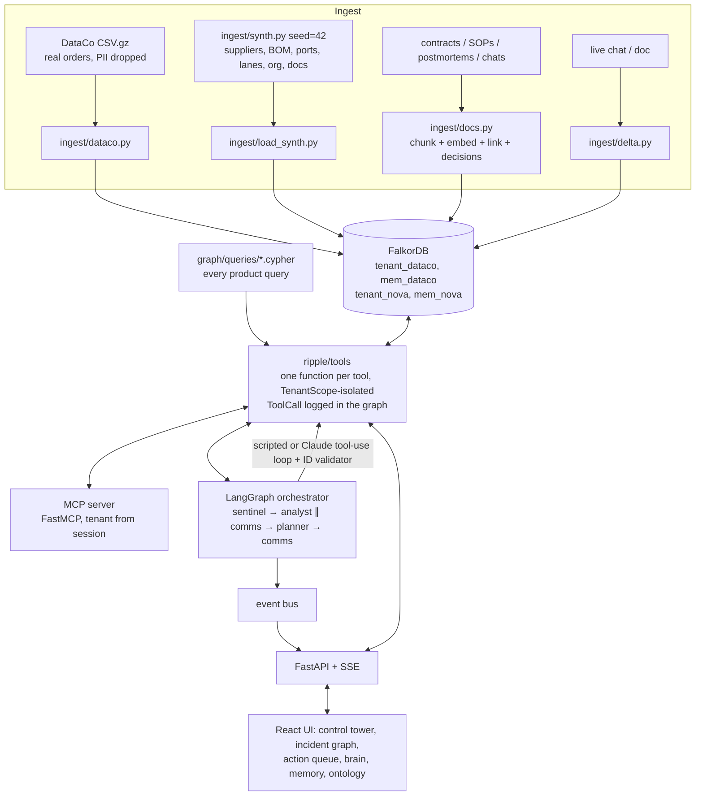
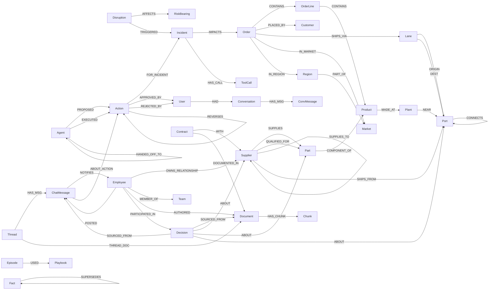

# Ripple: a graph-native supply chain control tower on FalkorDB

> **Graph Hacks: Context for AI Agents** (WeMakeDevs x FalkorDB), Oct 15-18, 2026.
> **Tracks entered: 01 (Agents That Act on Connected Data), 02 (Agent Memory and Coordination), 03 (Company Brain).**

A port closes, a tier-2 supplier burns, a carrier strikes. Ripple's four agents (Sentinel, Impact Analyst, Planner,
Comms) work on a Palantir-style **ontology stored in FalkorDB**: they trace the blast radius from the disruption to
the customer orders it hits and put a revenue figure on it, propose and execute mitigations that are written back
to the graph as auditable `Action`s, remember what happened last time (across restarts, per tenant), and answer
"who owns / why did we / what does the contract say" with sources. Every answer carries the node ids and edges of
the graph path that produced it.



| | |
|---|---|
|  |  |

## What a judge sees (3 acts, ~3.5 minutes)

1. **Act 1 (Track 01).** Trigger *Port of Shanghai closure*. Sentinel matches it to `PORT-CNSHA`, opens an
   incident and recalls a similar past episode. The Analyst walks
   `Disruption→Port←Lane←Order→OrderLine→Product←Part←Supplier` and finds the open orders, revenue and customers at
   risk (exactly equal to an independent pandas ground truth). Betweenness centrality flags chokepoints. The
   Planner follows the best playbook, runs weighted shortest paths around the closed port, proposes a reroute and
   notifies the relationship owner. A human approves; the reroute re-points `SHIPS_VIA` edges and **revenue at risk
   drops to $0**. The evidence drawer shows every node the action is `BASED_ON`.
2. **Act 2 (Track 02).** Close the incident (episode + playbook stats + temporal facts are written to the
   tenant's memory graph). Restart the process. Trigger *Ningbo port congestion*: Sentinel recalls the Shanghai
   episode from the previous session and the Planner reuses its playbook. Switch tenant to *Nova Retail*: different
   graphs, disjoint ids. The load test runs 20 concurrent sessions over both tenants with zero leaks and zero
   duplicate actions.
3. **Act 3 (Track 03).** Ask the company brain the five demo questions; each answer has source chips (contract,
   postmortem, chat thread, SOP) and a path. Post a chat message handing the Shenzhen Volt relationship to a new
   owner; ask again and the answer changes, citing the new message.

Terminal fallback of the same three acts: `.venv/bin/python scripts/demo.py`.

## Architecture



* **One implementation of every capability**: tools are plain Python functions `fn(scope, **args) -> ToolResult`
  (`data`, `node_ids`, `edges`, `queries`, `ms`). The MCP server, the agents, the API and the tests all call them.
* **Isolation in code**: a `TenantScope` can open only `tenant_<id>` and `mem_<id>`; MCP tool schemas have no
  tenant argument (the tenant comes from the session).
* **The Incident node is the blackboard**: LangGraph state holds only ids; agents read and write the graph and record
  `(:Agent)-[:HANDED_OFF_TO {incident_id, ts, summary}]->(:Agent)`. Writes are idempotent `MERGE`s on deterministic
  ids (`INC-`/`ACT-`/`EPI-` hashes), so re-runs and concurrent duplicates never create duplicates.
* **Two agent modes**: deterministic *scripted* (default, no key needed) and *LLM* (Claude, `claude-opus-5-5`, manual
  tool-use loop over the same registry tools). An **ID validator** rejects any answer that cites an id no tool
  returned; after one failed fix the agent falls back to its scripted logic.

## Why a graph (no FalkorDB, no product)

| Capability | What FalkorDB does | Without it |
|---|---|---|
| Blast radius | 5-7 hop traversals Disruption→Port←Lane←Order→OrderLine→Product←Part←Supplier, recomputed live after every action | 5-8 joins across ERP/TMS tables per question, stale after any change |
| Supplier failure | `SUPPLIES_TO*0..2` upstream expansion + "all active suppliers affected" check per part | recursive CTEs over three tiers |
| Chokepoints | `algo.betweenness`, `algo.pageRank`, `algo.WCC`, `algo.labelPropagation` on the supplier network | no hidden tier-2 chokepoint detection |
| Rerouting | `algo.SPpaths` weighted k-shortest paths over `CONNECTS`, filtered to avoid closed ports | hand-maintained routing tables |
| Actions | executing an action re-points `SHIPS_VIA` or turns `QUALIFIED_FOR` into `SUPPLIES`; revenue at risk drops because the traversal changes | a separate state machine with no link to the impact model |
| Company brain | vector index on chunks + `MENTIONS`/`ABOUT`/`SOURCED_FROM`/`OWNS_RELATIONSHIP` expansion | plain RAG: fragments, no owners, no decisions, no "why" |
| Memory | episodes, playbooks and temporal facts as nodes in a per-tenant memory graph that survives restarts | prompts that forget |

Every agent answer is a Cypher query or a graph algorithm call; the tool trace is visible in the UI timeline and as
`(:Incident)-[:HAS_CALL]->(:ToolCall)` in the graph.

## Graph data model (ontology)

Generated by `python -m ripple.ontology` from `ripple/ontology.py`. Do not edit.

Graphs: `tenant_<id>` (ops: operational data + company brain + incidents/actions) and `mem_<id>` (agent memory). Cross-graph references are id strings.

### Object types (node labels)

| Label | Graph | Description | Properties |
|---|---|---|---|
| `Supplier` | ops | A company that supplies parts (tier 1) or supplies other suppliers (tier 2/3). Synthetic. | `id` (SUP-T<tier>-NNNN), `name` (company name tagged [SYNTH]), `tier` (1, 2 or 3), `country` (ISO-2), `lat` (latitude), `lon` (longitude), `capacity` (units/month), `reliability` (0.6-0.99), `risk_score` (0-1), `synthetic` (always true) |
| `Part` | ops | A component in a product's bill of materials. | `id` (PRT-NNNN), `name` (part name), `category` (part family), `department` (DataCo department), `unit_cost` (USD), `criticality` (low|medium|high) |
| `Product` | ops | A DataCo product (real). | `id` (PRD-<Product Card Id>), `name` (product name), `category` (DataCo category), `department` (DataCo department), `price` (USD) |
| `Plant` | ops | A manufacturing plant (synthetic) where products are made. | `id` (PLT-NN), `name` (plant name), `country` (ISO-2), `lat`, `lon` |
| `Port` | ops | A real seaport (public name and coordinates). RiskBearing. | `id` (PORT-<UN/LOCODE>), `name` (port name), `country` (ISO-2), `lat`, `lon`, `status` (open|disrupted), `risk_score` (0-1) |
| `Lane` | ops | A shipping lane from an origin port to a destination port with a mode and carrier. RiskBearing. | `id` (LANE-<orig>-<dest>-<mode>), `mode` (DataCo Shipping Mode), `transit_days` (days), `carrier` (synthetic carrier), `risk_score` (0-1) |
| `Order` | ops | A DataCo order (real). Grouped from order items. | `id` (ORD-<Order Id>), `date` (ISO datetime), `status` (DataCo Order Status), `open` (status is open), `region` (Order Region), `market` (Market), `country` (Order Country), `city` (Order City), `total` (sum(Sales) of its lines, USD), `profit` (sum of Order Profit Per Order), `late_risk` (Late_delivery_risk (0/1)), `delivery_status`, `days_real`, `days_sched`, `shipping_mode` (Shipping Mode) |
| `OrderLine` | ops | One DataCo order item. | `id` (OL-<Order Item Id>), `qty`, `total` (Sales), `price` |
| `Customer` | ops | A DataCo customer. No names, emails or streets are loaded. | `id` (CUS-<Customer Id>), `segment`, `city`, `state`, `country` |
| `Market` | ops | DataCo market. | `id` (MKT-<name>), `name` |
| `Region` | ops | DataCo order region. | `id` (REG-<slug>), `name` |
| `Disruption` | ops | An event that affects RiskBearing nodes. | `id` (DIS-<hash>), `type` (port_closure|supplier_failure|carrier_strike), `name`, `severity`, `started_at` (epoch ms), `expected_days`, `source` (scenario|api|gdacs), `active` (bool) |
| `Incident` | ops | The shared blackboard that agents read and write. | `id` (INC-<hash>), `status` (open|closed), `type` (disruption type), `title`, `opened_at` (epoch ms), `closed_at`, `revenue_at_risk` (live USD), `revenue_at_risk_initial` (USD), `orders_at_risk`, `customers_affected`, `summary`, `mode` (scripted|llm) |
| `Action` | ops | A proposed or executed mitigation (Palantir-style action type). | `id` (ACT-<hash>), `type` (REROUTE_ORDERS|ACTIVATE_ALT_SUPPLIER|EXPEDITE|SPLIT_ORDER|NOTIFY_OWNER|PLACE_HOLD), `status` (proposed|approved|executed|rejected|undone), `params_json` (JSON), `created_at`, `executed_at`, `expected_impact` (USD), `undo_json` (before-state JSON), `summary` |
| `Agent` | ops | One of the four agents. | `id` (AGT-<name>), `name` (sentinel|analyst|planner|comms) |
| `ToolCall` | ops | One logged tool call (traceability). | `id` (TC-<uuid>), `tool`, `agent`, `args_json`, `ms`, `ts`, `n_nodes` |
| `User` | ops+mem | A human approver / chat user. | `id` (USR-<name>), `name` |
| `Employee` | ops | A synthetic employee. | `id` (EMP-NNN), `name` ([SYNTH]), `role`, `contact` (work email, @ripple-demo.example) |
| `Team` | ops | A team. | `id` (TEAM-<code>), `name` |
| `Contract` | ops | A supply contract with a tier-1 supplier. | `id` (CON-NNNN), `supplier_id`, `start`, `end`, `sla_days`, `penalty_pct` (per day late), `penalty_cap_pct`, `force_majeure` (bool), `exclusivity` (bool), `doc_id` |
| `Document` | ops | A contract, SOP, postmortem or chat thread. | `id` (DOC-...), `type` (contract|sop|postmortem|chat_thread), `title`, `uri` (repo path), `version`, `updated_at` (ISO date) |
| `Chunk` | ops | A paragraph-sized piece of a document with an embedding. | `id` (<doc id>#<n>), `text`, `ordinal`, `embedding` (vecf32(384)) |
| `Thread` | ops | A chat thread. | `id` (THR-...), `channel`, `title` |
| `ChatMessage` | ops | A company chat message (Slack-style). | `id` (MSG-...), `ts` (ISO datetime), `text`, `embedding` (vecf32(384)) |
| `Decision` | ops | A decision recorded in a postmortem or chat. | `id` (DEC-...), `summary`, `decided_at` (ISO date), `status` (active|superseded) |
| `Episode` | mem | Episodic memory: one closed incident. | `id` (EPI-...), `incident_id`, `disruption_type`, `entity_ids` (list), `countries` (list), `actions_taken` (list), `outcome` (resolved|partial|failed), `revenue_before`, `revenue_after`, `summary`, `embedding` (vecf32(384)), `ts` |
| `Playbook` | mem | Procedural memory: ordered action types with a success rate. | `id` (PB-...), `disruption_type`, `name`, `steps` (list of action types), `uses`, `successes`, `success_rate` |
| `Fact` | mem | Semantic memory: a temporal fact. | `id` (FACT-...), `subject_id` (ops node id), `predicate`, `object`, `valid_at` (epoch ms), `invalid_at` (epoch ms or null (current)), `source`, `confidence` |
| `Conversation` | mem | A chat with Ripple. | `id` (CONV-...), `user_id`, `started_at` |
| `ConvMessage` | mem | One turn of a chat with Ripple. | `id` (CMSG-...), `role` (user|assistant), `text`, `ts`, `sources_json` |

### Interfaces

| Label | On | Meaning |
|---|---|---|
| `RiskBearing` | Supplier, Port, Lane | Anything a Disruption can AFFECT; carries risk_score |

### Link types (relationships)

| Type | From → To | Properties | Description |
|---|---|---|---|
| `SUPPLIES` | Supplier → Part | lead_time_days, unit_cost, share | Active supply (tier 1) |
| `QUALIFIED_FOR` | Supplier → Part | qualified_on | Qualified alternate, not active |
| `SUPPLIES_TO` | Supplier → Supplier |  | Tier linkage: tier3 -> tier2 -> tier1 |
| `SHIPS_FROM` | Supplier → Port |  | Supplier's export port |
| `COMPONENT_OF` | Part → Product | qty | Bill of materials |
| `MADE_AT` | Product → Plant |  | Where a product is made |
| `NEAR` | Plant → Port | km | Plant's export port |
| `CONTAINS` | Order → OrderLine |  | Order items |
| `CONTAINS` | OrderLine → Product |  | Item's product |
| `PLACED_BY` | Order → Customer |  |  |
| `SHIPS_VIA` | Order → Lane |  | Current lane (re-pointed by REROUTE_ORDERS) |
| `ORIGIN` | Lane → Port |  |  |
| `DEST` | Lane → Port |  |  |
| `CONNECTS` | Port → Port | transit_days | Materialized from lanes for routing |
| `IN_MARKET` | Order → Market |  |  |
| `IN_REGION` | Order → Region |  |  |
| `PART_OF` | Region → Market |  |  |
| `AFFECTS` | Disruption → RiskBearing | severity |  |
| `TRIGGERED` | Disruption → Incident |  |  |
| `IMPACTS` | Incident → Order | revenue | Top impacted orders |
| `HAS_CALL` | Incident → ToolCall |  | Tool trace |
| `PROPOSED` | Agent → Action | ts |  |
| `EXECUTED` | Agent → Action | ts |  |
| `BASED_ON` | Action → any | role | Evidence |
| `FOR_INCIDENT` | Action → Incident |  |  |
| `APPROVED_BY` | Action → User | ts | Governance |
| `REJECTED_BY` | Action → User | ts |  |
| `REVERSES` | Action → Action |  | Undo |
| `NOTIFIES` | ChatMessage → Employee |  | Drafted notification |
| `ABOUT_ACTION` | ChatMessage → Action |  |  |
| `HANDED_OFF_TO` | Agent → Agent | incident_id, ts, summary | Handoff between agent steps |
| `OWNS_RELATIONSHIP` | Employee → Supplier | valid_from, valid_to | Temporal ownership |
| `MEMBER_OF` | Employee → Team |  |  |
| `WITH` | Contract → Supplier |  |  |
| `DOCUMENTED_IN` | Contract → Document |  |  |
| `HAS_CHUNK` | Document → Chunk |  |  |
| `MENTIONS` | Chunk|ChatMessage → any | confidence | Entity linking |
| `AUTHORED` | Employee → Document |  |  |
| `POSTED` | Employee → ChatMessage |  |  |
| `HAS_MSG` | Thread → ChatMessage |  |  |
| `THREAD_DOC` | Thread → Document |  | The thread's citable document |
| `SOURCED_FROM` | Decision → Document|ChatMessage |  | Where a decision was made |
| `ABOUT` | Decision → Supplier|Part|Port |  |  |
| `PARTICIPATED_IN` | Employee → Decision |  |  |
| `USED` | Episode → Playbook |  | mem graph |
| `SUPERSEDES` | Fact → Fact |  | mem graph: newer fact supersedes older |
| `HAD` | User → Conversation |  | mem graph |
| `HAS_MSG` | Conversation → ConvMessage |  | mem graph |

### Diagram



## Cypher queries and graph algorithms

Every query the product runs lives in [`graph/queries/`](graph/queries) (one file each, with a header: name,
purpose, kind, example params) and is loaded by name (`ripple/graph/queries.py`). This section is generated from
those headers by `scripts/build_docs.py`, so the README and the code cannot drift apart. `tests/test_queries.py`
runs every file with its example params.

### Key queries

**Q1. `blast_radius_port`**: Q1. Blast radius of a port closure: Disruption-AFFECTS->Port<-ORIGIN|DEST-Lane<-SHIPS_VIA-Order(open)-PLACED_BY->Customer.

```cypher
MATCH (d:Disruption {id: $did})-[:AFFECTS]->(port:Port)
MATCH (port)<-[:ORIGIN|DEST]-(lane:Lane)<-[:SHIPS_VIA]-(o:Order {open: true})
WITH DISTINCT o, lane
MATCH (o)-[:PLACED_BY]->(c:Customer)
RETURN count(o) AS orders_at_risk, sum(o.total) AS revenue_at_risk, count(DISTINCT c) AS customers_affected,
       collect(DISTINCT lane.id) AS lanes, collect([o.id, o.total]) AS orders
```

**Q2. `blast_radius_supplier`**: Q2. Blast radius of a supplier failure: affected = failed supplier + SUPPLIES_TO*0..2 downstream; parts whose every active supplier is affected; their products' open orders.

```cypher
MATCH (d:Disruption {id: $did})-[:AFFECTS]->(s0:Supplier)
MATCH (s0)-[:SUPPLIES_TO*0..2]->(s1:Supplier)
WITH collect(DISTINCT s1) AS affected
UNWIND affected AS a
MATCH (a)-[:SUPPLIES]->(pt:Part)
WITH DISTINCT pt, affected
MATCH (pt)<-[:SUPPLIES]-(x:Supplier)
WITH pt, affected, collect(x) AS sups
WITH affected, collect(CASE WHEN all(y IN sups WHERE y IN affected) THEN pt END) AS impacted,
     collect(CASE WHEN all(y IN sups WHERE y IN affected) THEN NULL ELSE pt.id END) AS degraded
UNWIND impacted AS pt
MATCH (pt)-[:COMPONENT_OF]->(pr:Product)<-[:CONTAINS]-(:OrderLine)<-[:CONTAINS]-(o:Order {open: true})
WITH affected, degraded, collect(DISTINCT pt.id) AS parts, collect(DISTINCT pr.id) AS products, collect(DISTINCT o) AS os
UNWIND os AS o
MATCH (o)-[:PLACED_BY]->(c:Customer)
RETURN count(o) AS orders_at_risk, sum(o.total) AS revenue_at_risk, count(DISTINCT c) AS customers_affected,
       collect([o.id, o.total]) AS orders, parts, products, degraded, [a IN affected | a.id] AS suppliers
```

**Q3. `single_sourced_parts`**: Q3. Single-sourced parts (exactly one active supplier) and how many products depend on each.

```cypher
MATCH (pt:Part)<-[:SUPPLIES]-(s:Supplier)
WITH pt, count(s) AS n, collect(s) AS sups
WHERE n = 1
MATCH (pt)-[:COMPONENT_OF]->(pr:Product)
RETURN pt.id AS part_id, pt.name AS part, pt.criticality AS criticality, sups[0].id AS sole_supplier_id,
       sups[0].name AS sole_supplier, count(pr) AS products_dependent
ORDER BY products_dependent DESC, part_id LIMIT $limit
```

**Q4. `alt_suppliers`**: Q4. Qualified or active alternate suppliers for a part outside a blocked country, excluding suppliers hit by an active disruption directly or upstream (SUPPLIES_TO*1..2).

```cypher
MATCH (pt:Part {id: $part})<-[q:QUALIFIED_FOR|SUPPLIES]-(s:Supplier)
WHERE ($exclude_country IS NULL OR s.country <> $exclude_country)
  AND NOT (s)<-[:AFFECTS]-(:Disruption {active: true})
  AND NOT (s)<-[:SUPPLIES_TO*1..2]-(:Supplier)<-[:AFFECTS]-(:Disruption {active: true})
RETURN s.id AS id, s.name AS name, s.country AS country, s.reliability AS reliability,
       coalesce(q.lead_time_days, 21) AS lead_time, q.unit_cost AS unit_cost, type(q) AS relation
ORDER BY CASE type(q) WHEN 'QUALIFIED_FOR' THEN 0 ELSE 1 END, reliability DESC, lead_time ASC
LIMIT $limit
```

**Q5. `late_risk_baseline`**: Q5. Historical late-delivery rate (DataCo Late_delivery_risk labels) for a shipping mode and market.

```cypher
MATCH (o:Order)-[:SHIPS_VIA]->(l:Lane)
WHERE l.mode = $mode AND o.market = $market
RETURN avg(o.late_risk) AS late_rate, count(o) AS sample
```

**Q6. `who_owns`**: Q6. Who owns the supplier relationship at a point in time (temporal OWNS_RELATIONSHIP window) and their team.

```cypher
MATCH (e:Employee)-[r:OWNS_RELATIONSHIP]->(s:Supplier {id: $sid})
WHERE r.valid_from <= $now AND (r.valid_to IS NULL OR r.valid_to > $now)
OPTIONAL MATCH (e)-[:MEMBER_OF]->(t:Team)
RETURN s.id AS supplier_id, s.name AS supplier, e.id AS employee_id, e.name AS name, e.role AS role,
       t.id AS team_id, t.name AS team, r.valid_from AS valid_from, r.valid_to AS valid_to
```

**Q7. `trace_decision`**: Q7. Trace decisions ABOUT entities to their sources (documents and chat messages) and the people involved.

```cypher
MATCH (dec:Decision)-[:ABOUT]->(x)
WHERE x.id IN $ids
MATCH (dec)-[:SOURCED_FROM]->(src)
OPTIONAL MATCH (author:Employee)-[:AUTHORED|POSTED]->(src)
OPTIONAL MATCH (th:Thread)-[:HAS_MSG]->(src)
OPTIONAL MATCH (th)-[:THREAD_DOC]->(td:Document)
OPTIONAL MATCH (p:Employee)-[:PARTICIPATED_IN]->(dec)
RETURN dec.id AS decision_id, dec.summary AS summary, dec.decided_at AS decided_at, labels(src)[0] AS source_type,
       src.id AS source_id, coalesce(src.title, src.text) AS source_text, coalesce(src.uri, td.uri) AS uri,
       td.id AS thread_doc, collect(DISTINCT author.name) AS authors, collect(DISTINCT p.name) AS people
ORDER BY decided_at DESC
```

**Q8. `doc_search`**: Q8. Ontology-augmented doc search: vector search over chunks, then expand to the document and the entities each chunk MENTIONS; optional entity scope filter.

```cypher
CALL db.idx.vector.queryNodes('Chunk', 'embedding', $k, vecf32($qvec)) YIELD node AS ch, score
MATCH (doc:Document)-[:HAS_CHUNK]->(ch)
OPTIONAL MATCH (ch)-[:MENTIONS]->(ent)
WITH doc, ch, score, collect(DISTINCT ent) AS ents
WHERE size($scope) = 0 OR any(e IN ents WHERE e.id IN $scope)
RETURN doc.id AS doc_id, doc.title AS title, doc.uri AS uri, doc.type AS type, ch.id AS chunk_id, ch.text AS text,
       score, [e IN ents | e.id] AS entity_ids, [e IN ents | e.name] AS entities
ORDER BY score ASC
```

**Q9. `action_get`**: Q9. An action with its evidence, proposing agent and approver (explainability panel).

```cypher
MATCH (a:Action {id: $aid})
OPTIONAL MATCH (a)-[b:BASED_ON]->(ev)
OPTIONAL MATCH (ag:Agent)-[:PROPOSED]->(a)
OPTIONAL MATCH (a)-[:APPROVED_BY]->(u:User)
OPTIONAL MATCH (a)-[:FOR_INCIDENT]->(i:Incident)
RETURN a {.*} AS action, ag.name AS agent, u.id AS approved_by, i.id AS incident_id,
       collect(DISTINCT {label: labels(ev)[0], id: ev.id, name: coalesce(ev.name, ev.title, ev.id), role: b.role}) AS evidence
```

**Q10a. `betweenness_suppliers`**: Q10a. Exact betweenness centrality over the supplier network (SUPPLIES_TO; samplingSize above the node count = every source): chokepoints sit between many tier-3 and tier-1 suppliers.

```cypher
CALL algo.betweenness({nodeLabels: ['Supplier'], relationshipTypes: ['SUPPLIES_TO'], samplingSize: 100000, samplingSeed: 42}) YIELD node, score
RETURN node.id AS id, node.name AS name, node.tier AS tier, node.country AS country, score
ORDER BY score DESC LIMIT $top_k
```

**Q10b. `pagerank_suppliers`**: Q10b. PageRank over SUPPLIES_TO: suppliers that many important suppliers feed into.

```cypher
CALL algo.pageRank('Supplier', 'SUPPLIES_TO') YIELD node, score
RETURN node.id AS id, node.name AS name, node.tier AS tier, node.country AS country, score
ORDER BY score DESC LIMIT $top_k
```

**Q10c. `alt_route`**: Q10c. Weighted k-shortest sea routes over CONNECTS (algo.SPpaths, weight transit_days), dropping any route through an avoided port.

```cypher
MATCH (a:Port {id: $from}), (b:Port {id: $to})
CALL algo.SPpaths({sourceNode: a, targetNode: b, relTypes: ['CONNECTS'], weightProp: 'transit_days', maxLen: 6, pathCount: 20})
YIELD path, pathWeight
WITH path, pathWeight WHERE NONE(n IN nodes(path) WHERE n.id IN $avoid)
RETURN [n IN nodes(path) | n.id] AS route, pathWeight AS transit_days
ORDER BY transit_days LIMIT 3
```

**live. `revenue_at_risk`**: Live revenue at risk for an incident: union of the port, lane and supplier impact definitions, recomputed on every call (respects reroutes and supplier switches).

```cypher
MATCH (i:Incident {id: $iid})<-[:TRIGGERED]-(d:Disruption)
CALL {
  WITH d
  MATCH (d)-[:AFFECTS]->(:Port)<-[:ORIGIN|DEST]-(:Lane)<-[:SHIPS_VIA]-(o:Order {open: true})
  RETURN o
  UNION
  WITH d
  MATCH (d)-[:AFFECTS]->(:Lane)<-[:SHIPS_VIA]-(o:Order {open: true})
  RETURN o
  UNION
  WITH d
  MATCH (d)-[:AFFECTS]->(s0:Supplier)
  MATCH (s0)-[:SUPPLIES_TO*0..2]->(s1:Supplier)
  WITH collect(DISTINCT s1) AS affected
  UNWIND affected AS a
  MATCH (a)-[:SUPPLIES]->(pt:Part)
  WITH DISTINCT pt, affected
  MATCH (pt)<-[:SUPPLIES]-(x:Supplier)
  WITH pt, affected, collect(x) AS sups
  WHERE all(y IN sups WHERE y IN affected)
  MATCH (pt)-[:COMPONENT_OF]->(:Product)<-[:CONTAINS]-(:OrderLine)<-[:CONTAINS]-(o:Order {open: true})
  RETURN o
}
WITH DISTINCT o
RETURN count(o) AS orders, sum(o.total) AS revenue, collect(o.id) AS order_ids
```

**action. `exec_reroute`**: Action effect REROUTE_ORDERS: re-point SHIPS_VIA from the disrupted lane to an alternate lane (created if needed) and push days_sched.

```cypher
UNWIND $moves AS m
MERGE (nl:Lane {id: m.to_lane})
ON CREATE SET nl:RiskBearing, nl.mode = m.mode, nl.transit_days = m.transit_days, nl.carrier = m.carrier,
              nl.risk_score = 0.2, nl.created_by = $aid
WITH m, nl
MATCH (po:Port {id: m.to_origin})
MATCH (pd:Port {id: m.to_dest})
MERGE (nl)-[:ORIGIN]->(po)
MERGE (nl)-[:DEST]->(pd)
WITH m, nl
UNWIND m.order_ids AS oid
MATCH (o:Order {id: oid})-[r:SHIPS_VIA]->(old:Lane {id: m.from_lane})
DELETE r
CREATE (o)-[:SHIPS_VIA]->(nl)
SET o.days_sched = o.days_sched + m.added_days
RETURN count(o) AS moved
```

### All 148 query files

#### Impact and blast radius

| File | Kind | Graph | Purpose |
|---|---|---|---|
| [`blast_paths_carrier`](graph/queries/blast_paths_carrier.cypher) | read | ops | Highlight subgraph for a carrier strike: affected lanes with ports, top orders and customers. |
| [`blast_paths_port`](graph/queries/blast_paths_port.cypher) | read | ops | Highlight subgraph for a port closure: top orders by value with their lane, customer and products. |
| [`blast_paths_supplier`](graph/queries/blast_paths_supplier.cypher) | read | ops | Highlight subgraph for a supplier failure: SUPPLIES_TO chains from the failed supplier to the impacted parts and their products. |
| [`blast_radius_carrier`](graph/queries/blast_radius_carrier.cypher) | read | ops | Blast radius of a carrier strike: Disruption-AFFECTS->Lane<-SHIPS_VIA-Order(open)-PLACED_BY->Customer. |
| [`blast_radius_port`](graph/queries/blast_radius_port.cypher) | read | ops | Q1. Blast radius of a port closure: Disruption-AFFECTS->Port<-ORIGIN/DEST-Lane<-SHIPS_VIA-Order(open)-PLACED_BY->Customer. |
| [`blast_radius_supplier`](graph/queries/blast_radius_supplier.cypher) | read | ops | Q2. Blast radius of a supplier failure: affected = failed supplier + SUPPLIES_TO*0..2 downstream; parts whose every active supplier is affected; their products' open orders. |
| [`create_disruption`](graph/queries/create_disruption.cypher) | write | ops | Write: MERGE a Disruption by deterministic id and link it to the RiskBearing nodes it AFFECTS. |
| [`customer_exposure`](graph/queries/customer_exposure.cypher) | read | ops | Top customers by live revenue at risk in an incident. |
| [`customer_segments`](graph/queries/customer_segments.cypher) | read | ops | Live revenue at risk per customer segment and market in an incident. |
| [`disruptions_active`](graph/queries/disruptions_active.cypher) | read | ops | Active disruptions with what they affect (lanes collapsed to a count). |
| [`impact_expand`](graph/queries/impact_expand.cypher) | read | ops | Multi-hop expansion of an impact set: Order-CONTAINS->OrderLine-CONTAINS->Product<-COMPONENT_OF-Part<-SUPPLIES-Supplier, Product-MADE_AT->Plant. |
| [`impact_mode_market`](graph/queries/impact_mode_market.cypher) | read | ops | The (shipping mode, market) pairs carrying most revenue in an impact set. |
| [`incident_actions`](graph/queries/incident_actions.cypher) | read | ops | Actions of an incident with status (for episodes and the incident view). |
| [`incident_get`](graph/queries/incident_get.cypher) | read | ops | Read an incident with its disruption and affected entities. |
| [`incident_handoffs`](graph/queries/incident_handoffs.cypher) | read | ops | Handoffs recorded for an incident, in order. |
| [`incident_tool_calls`](graph/queries/incident_tool_calls.cypher) | read | ops | Tool calls logged for an incident (used to replay the timeline after a restart). |
| [`incidents_list`](graph/queries/incidents_list.cypher) | read | ops | All incidents, newest first, with their numbers. |
| [`late_risk_baseline`](graph/queries/late_risk_baseline.cypher) | read | ops | Q5. Historical late-delivery rate (DataCo Late_delivery_risk labels) for a shipping mode and market. |
| [`match_by_id`](graph/queries/match_by_id.cypher) | read | ops | Event matching: a RiskBearing node by id. |
| [`match_lanes_by_carrier`](graph/queries/match_lanes_by_carrier.cypher) | read | ops | Event matching: every lane operated by a carrier (carrier strike). |
| [`match_near_point`](graph/queries/match_near_point.cypher) | read | ops | Event matching: every port and supplier with coordinates; the haversine radius filter runs in Python. |
| [`match_port_by_name`](graph/queries/match_port_by_name.cypher) | read | ops | Event matching: ports whose name contains the event's target name. |
| [`match_supplier_by_name`](graph/queries/match_supplier_by_name.cypher) | read | ops | Event matching: suppliers whose name (or id) matches the event's target. |
| [`open_incident`](graph/queries/open_incident.cypher) | write | ops | Write: MERGE the Incident (shared blackboard) for a disruption, Disruption-[:TRIGGERED]->Incident. |
| [`related_suppliers`](graph/queries/related_suppliers.cypher) | read | ops | Suppliers related to an incident's disruption: those shipping from an affected port, or the failed supplier and its tier-1 customers; contract holders first. |
| [`revenue_at_risk`](graph/queries/revenue_at_risk.cypher) | read | ops | Live revenue at risk for an incident: union of the port, lane and supplier impact definitions, recomputed on every call (respects reroutes and supplier switches). |
| [`set_incident_context`](graph/queries/set_incident_context.cypher) | write | ops | Write: Comms prefetch puts related suppliers and their owners on the Incident blackboard. |
| [`set_incident_impact`](graph/queries/set_incident_impact.cypher) | write | ops | Write: blast-radius numbers on the Incident blackboard (initial values kept for before/after). |
| [`set_incident_live`](graph/queries/set_incident_live.cypher) | write | ops | Write: refresh the live revenue/orders at risk on the Incident. |
| [`set_incident_playbook`](graph/queries/set_incident_playbook.cypher) | write | ops | Write: record on the Incident blackboard which playbook the Planner is following and what Sentinel recalled. |
| [`set_incident_summary`](graph/queries/set_incident_summary.cypher) | write | ops | Write: final Comms summary on the Incident blackboard. |
| [`top_orders_for_products`](graph/queries/top_orders_for_products.cypher) | read | ops | Highlight helper: the most valuable open orders containing the given products. |
| [`write_impacts`](graph/queries/write_impacts.cypher) | write | ops | Write: Incident-[:IMPACTS {revenue}]->Order for the impact set. |

#### Algorithms and routing

| File | Kind | Graph | Purpose |
|---|---|---|---|
| [`alt_route`](graph/queries/alt_route.cypher) | algo | ops | Q10c. Weighted k-shortest sea routes over CONNECTS (algo.SPpaths, weight transit_days), dropping any route through an avoided port. |
| [`alt_route_unweighted`](graph/queries/alt_route_unweighted.cypher) | algo | ops | Fallback route: unweighted shortestPath over CONNECTS inside WITH, rejected if it touches an avoided port. |
| [`betweenness_suppliers`](graph/queries/betweenness_suppliers.cypher) | algo | ops | Q10a. Exact betweenness centrality over the supplier network (SUPPLIES_TO; samplingSize above the node count = every source): chokepoints sit between many tier-3 and tier-1 suppliers. |
| [`cdlp_suppliers`](graph/queries/cdlp_suppliers.cypher) | algo | ops | Community detection (label propagation) over the supplier network. |
| [`lanes_get`](graph/queries/lanes_get.cypher) | read | ops | Lanes by id with their origin and destination ports (reroute planning). |
| [`pagerank_suppliers`](graph/queries/pagerank_suppliers.cypher) | algo | ops | Q10b. PageRank over SUPPLIES_TO: suppliers that many important suppliers feed into. |
| [`port_coords`](graph/queries/port_coords.cypher) | read | ops | All ports with coordinates (for nearest-open-port search in alt_route). |
| [`single_sourced_parts`](graph/queries/single_sourced_parts.cypher) | read | ops | Q3. Single-sourced parts (exactly one active supplier) and how many products depend on each. |
| [`supplier_downstream`](graph/queries/supplier_downstream.cypher) | read | ops | Tier-1 suppliers reachable downstream (SUPPLIES_TO*0..2) from each given supplier. |
| [`supplier_network_version`](graph/queries/supplier_network_version.cypher) | read | ops | Cheap fingerprint of the supplier network (node and SUPPLIES_TO edge counts) used to invalidate cached algorithm results. |
| [`wcc_suppliers`](graph/queries/wcc_suppliers.cypher) | algo | ops | Weakly connected components of the supplier network (correlated risk groups). |

#### Sourcing and contracts

| File | Kind | Graph | Purpose |
|---|---|---|---|
| [`alt_suppliers`](graph/queries/alt_suppliers.cypher) | read | ops | Q4. Qualified or active alternate suppliers for a part outside a blocked country, excluding suppliers hit by an active disruption directly or upstream (SUPPLIES_TO*1..2). |
| [`contract_clause_search`](graph/queries/contract_clause_search.cypher) | read | ops | Vector search scoped to one contract's chunks (vec.cosineDistance; lower = closer). |
| [`contract_for_supplier`](graph/queries/contract_for_supplier.cypher) | read | ops | The contract with a supplier and the document it lives in. |
| [`supplier_exposure`](graph/queries/supplier_exposure.cypher) | read | ops | Open orders impacted by an incident that contain a part supplied by a given supplier. |
| [`suppliers_at_ports`](graph/queries/suppliers_at_ports.cypher) | read | ops | Suppliers that ship from the given ports. |

#### Actions (write-back)

| File | Kind | Graph | Purpose |
|---|---|---|---|
| [`action_evidence_edges`](graph/queries/action_evidence_edges.cypher) | read | ops | Actions of an incident with their BASED_ON evidence (for the incident graph). |
| [`action_get`](graph/queries/action_get.cypher) | read | ops | Q9. An action with its evidence, proposing agent and approver (explainability panel). |
| [`actions_list`](graph/queries/actions_list.cypher) | read | ops | Action queue: actions filtered by status and/or incident, newest first. |
| [`approve_action`](graph/queries/approve_action.cypher) | write | ops | Write: approve a proposed action; Action-[:APPROVED_BY]->User (governance). |
| [`claim_execution`](graph/queries/claim_execution.cypher) | write | ops | Write: atomically move an approved action to 'executing' so it can only run once. |
| [`create_reverse_action`](graph/queries/create_reverse_action.cypher) | write | ops | Write: the reverse Action created by undo; ReverseAction-[:REVERSES]->Action, original status 'undone'. |
| [`exec_activate_alt_supplier`](graph/queries/exec_activate_alt_supplier.cypher) | write | ops | Action effect ACTIVATE_ALT_SUPPLIER: turn QUALIFIED_FOR into SUPPLIES {share} and scale down the existing suppliers' shares. |
| [`exec_expedite`](graph/queries/exec_expedite.cypher) | write | ops | Action effect EXPEDITE: flag orders as expedited, pull days_sched in by 2 and record the freight cost delta. |
| [`exec_notify_owner`](graph/queries/exec_notify_owner.cypher) | write | ops | Action effect NOTIFY_OWNER: post the notification as a ChatMessage to the owner; ChatMessage-[:NOTIFIES]->Employee, -[:ABOUT_ACTION]->Action. |
| [`exec_place_hold`](graph/queries/exec_place_hold.cypher) | write | ops | Action effect PLACE_HOLD: set orders ON_HOLD with a reason (still open, still at risk). |
| [`exec_reroute`](graph/queries/exec_reroute.cypher) | write | ops | Action effect REROUTE_ORDERS: re-point SHIPS_VIA from the disrupted lane to an alternate lane (created if needed) and push days_sched. |
| [`exec_split_order`](graph/queries/exec_split_order.cypher) | write | ops | Action effect SPLIT_ORDER: create a child Order on another lane carrying a fraction of the value. |
| [`finish_execution`](graph/queries/finish_execution.cypher) | write | ops | Write: mark an action executed with its before-state (undo_json); Agent-[:EXECUTED]->Action. |
| [`link_evidence`](graph/queries/link_evidence.cypher) | write | ops | Write: Action-[:BASED_ON {role}]->evidence node. |
| [`nodes_exist`](graph/queries/nodes_exist.cypher) | read | ops | Which of the given ids exist (any evidence-capable label, all index lookups). |
| [`orders_lanes`](graph/queries/orders_lanes.cypher) | read | ops | Current lane and schedule of the given orders (before-state for reroutes). |
| [`owners_for_entities`](graph/queries/owners_for_entities.cypher) | read | ops | Current relationship owners (Q6 pattern) for a list of suppliers. |
| [`propose_action`](graph/queries/propose_action.cypher) | write | ops | Write: MERGE a proposed Action (deterministic id) for an incident; Agent-[:PROPOSED]->Action-[:FOR_INCIDENT]->Incident. |
| [`reject_action`](graph/queries/reject_action.cypher) | write | ops | Write: reject a proposed action; Action-[:REJECTED_BY]->User. |
| [`supplier_part_state`](graph/queries/supplier_part_state.cypher) | read | ops | Before-state for a supplier switch: active SUPPLIES shares and the QUALIFIED_FOR link. |
| [`undo_activate_alt_supplier`](graph/queries/undo_activate_alt_supplier.cypher) | write | ops | Undo ACTIVATE_ALT_SUPPLIER: drop the new SUPPLIES, restore QUALIFIED_FOR and the old shares. |
| [`undo_expedite`](graph/queries/undo_expedite.cypher) | write | ops | Undo EXPEDITE: restore schedule and clear the expedite flag. |
| [`undo_notify_owner`](graph/queries/undo_notify_owner.cypher) | write | ops | Undo NOTIFY_OWNER: mark the notification retracted. |
| [`undo_place_hold`](graph/queries/undo_place_hold.cypher) | write | ops | Undo PLACE_HOLD: restore each order's previous status. |
| [`undo_reroute`](graph/queries/undo_reroute.cypher) | write | ops | Undo REROUTE_ORDERS: put orders back on their original lane and schedule. |
| [`undo_split_order`](graph/queries/undo_split_order.cypher) | write | ops | Undo SPLIT_ORDER: delete the child order and restore the parent's value. |

#### Agents and coordination

| File | Kind | Graph | Purpose |
|---|---|---|---|
| [`handoff`](graph/queries/handoff.cypher) | write | ops | Write: Agent-[:HANDED_OFF_TO {incident_id, ts, summary}]->Agent (one edge per incident and pair, idempotent). |
| [`log_tool_call`](graph/queries/log_tool_call.cypher) | write | ops | Write: one ToolCall node per tool invocation, linked from the incident when there is one. |

#### Memory graph

| File | Kind | Graph | Purpose |
|---|---|---|---|
| [`bump_risk`](graph/queries/bump_risk.cypher) | write | ops | Write: semantic memory feeds back into the ops graph: raise risk_score of entities hit by an incident. |
| [`close_incident`](graph/queries/close_incident.cypher) | write | ops | Write: close the incident, deactivate its disruption and reset the status of what it affected. |
| [`conversations_all`](graph/queries/conversations_all.cypher) | read | mem | Memory inspector: every user's conversation counts. |
| [`conversations_for_user`](graph/queries/conversations_for_user.cypher) | read | mem | Memory (conversation): a user's conversations with their messages. |
| [`episode_vector_search`](graph/queries/episode_vector_search.cypher) | read | mem | Memory (episodic): vector distance between a query and episode summaries (lower = closer). |
| [`episodes_all`](graph/queries/episodes_all.cypher) | read | mem | Memory (episodic): every episode with its playbook (recall scoring runs in Python). |
| [`fact_create`](graph/queries/fact_create.cypher) | write | mem | Memory (semantic): create a fact; if it contradicts the current one, close the old window (invalid_at) and link Fact-[:SUPERSEDES]->Fact. |
| [`fact_current`](graph/queries/fact_current.cypher) | read | mem | Memory (semantic): the current (invalid_at IS NULL) fact for a subject and predicate. |
| [`facts_about`](graph/queries/facts_about.cypher) | read | mem | Memory (semantic): facts about a subject, current only or with history (validity windows). |
| [`facts_recent`](graph/queries/facts_recent.cypher) | read | mem | Memory inspector: most recent facts. |
| [`get_playbook`](graph/queries/get_playbook.cypher) | read | mem | Memory (procedural): best playbook for a disruption type by success rate, then uses. |
| [`log_conversation_turn`](graph/queries/log_conversation_turn.cypher) | write | mem | Memory (conversation): (:User)-[:HAD]->(:Conversation)-[:HAS_MSG]->(:ConvMessage). |
| [`playbook_outcome`](graph/queries/playbook_outcome.cypher) | write | mem | Memory (procedural): count one more use (and success) of a playbook and refresh its success rate. |
| [`playbooks_list`](graph/queries/playbooks_list.cypher) | read | mem | Memory inspector: all playbooks. |
| [`record_episode`](graph/queries/record_episode.cypher) | write | mem | Memory (episodic): MERGE an Episode for a closed incident and link the Playbook it USED; returns whether it was new. |
| [`upsert_playbook`](graph/queries/upsert_playbook.cypher) | write | mem | Memory (procedural): seed or update a Playbook. |

#### Company brain

| File | Kind | Graph | Purpose |
|---|---|---|---|
| [`decisions_all`](graph/queries/decisions_all.cypher) | read | ops | Every decision with what it is ABOUT (for keyword matching of 'why' and 'what changed' questions). |
| [`delta_upsert_thread`](graph/queries/delta_upsert_thread.cypher) | write | ops | Delta ingest: MERGE the live chat thread for a channel and its citable Document. |
| [`doc_search`](graph/queries/doc_search.cypher) | read | ops | Q8. Ontology-augmented doc search: vector search over chunks, then expand to the document and the entities each chunk MENTIONS; optional entity scope filter. |
| [`doc_version`](graph/queries/doc_version.cypher) | read | ops | Delta ingest: current version of a document (to bump it on re-ingest). |
| [`docs_changed_since`](graph/queries/docs_changed_since.cypher) | read | ops | Documents revised (version > 1) since a date: what changed in policy. |
| [`docs_get`](graph/queries/docs_get.cypher) | read | ops | Documents by id (title, uri, first chunk) for citations. |
| [`employees_list`](graph/queries/employees_list.cypher) | read | ops | Employees with team (author picker in the brain UI). |
| [`handover_close`](graph/queries/handover_close.cypher) | write | ops | Delta ingest: close the current OWNS_RELATIONSHIP window of a supplier (valid_to = today). |
| [`handover_open`](graph/queries/handover_open.cypher) | write | ops | Delta ingest: open a new OWNS_RELATIONSHIP window (valid_from = today) for the new owner. |
| [`owner_sources`](graph/queries/owner_sources.cypher) | read | ops | Documents that support an ownership answer: the supplier's contract and chat messages mentioning both the supplier and the owner. |
| [`ownership_history`](graph/queries/ownership_history.cypher) | read | ops | Every ownership window for a supplier, newest first. |
| [`suppliers_for_entity`](graph/queries/suppliers_for_entity.cypher) | read | ops | Suppliers behind a part (active SUPPLIES) or a port (SHIPS_FROM), for ownership questions. |
| [`team_backups`](graph/queries/team_backups.cypher) | read | ops | Backups for an owner: other members of the owner's team, past owners of the supplier first. |
| [`trace_decision`](graph/queries/trace_decision.cypher) | read | ops | Q7. Trace decisions ABOUT entities to their sources (documents and chat messages) and the people involved. |
| [`trace_decision_ids`](graph/queries/trace_decision_ids.cypher) | read | ops | Q7 by decision id: a decision's sources and the people involved. |
| [`who_knows`](graph/queries/who_knows.cypher) | read | ops | Expertise ranking: employees who AUTHORED documents, POSTED messages or PARTICIPATED_IN decisions that MENTION / are ABOUT the given entities (weights 2/1/3). |
| [`who_knows_docs`](graph/queries/who_knows_docs.cypher) | read | ops | Expertise for a topic: authors of, posters in, and decision participants from the documents a doc_search found (postmortems weigh 3, chats 2, others 1). |
| [`who_owns`](graph/queries/who_owns.cypher) | read | ops | Q6. Who owns the supplier relationship at a point in time (temporal OWNS_RELATIONSHIP window) and their team. |

#### UI and API

| File | Kind | Graph | Purpose |
|---|---|---|---|
| [`map_plants`](graph/queries/map_plants.cypher) | read | ops | Map layer: plants with their export port. |
| [`map_ports`](graph/queries/map_ports.cypher) | read | ops | Map layer: ports with coordinates, status and risk. |
| [`map_suppliers`](graph/queries/map_suppliers.cypher) | read | ops | Map layer: suppliers with coordinates, tier, risk and status. |
| [`meta_stats`](graph/queries/meta_stats.cypher) | read | ops | Label and relationship-type counts for the ontology page (db.meta.stats()). |
| [`tenant_counts`](graph/queries/tenant_counts.cypher) | read | ops | Node and relationship totals for a tenant graph. |

<details><summary>Ingest (32 files)</summary>

| File | Kind | Graph | Purpose |
|---|---|---|---|
| [`link_decision_about`](graph/queries/link_decision_about.cypher) | write | ops | Ingest. Decision-[:ABOUT]->Supplier/Part/Port. |
| [`link_decision_people`](graph/queries/link_decision_people.cypher) | write | ops | Ingest. Employee-[:PARTICIPATED_IN]->Decision. |
| [`link_decision_sources`](graph/queries/link_decision_sources.cypher) | write | ops | Ingest. Decision-[:SOURCED_FROM]->Document/ChatMessage. |
| [`load_authored`](graph/queries/load_authored.cypher) | write | ops | Ingest. Employee-[:AUTHORED]->Document. |
| [`load_bom`](graph/queries/load_bom.cypher) | write | ops | Ingest. Part-[:COMPONENT_OF {qty}]->Product. |
| [`load_chat_messages`](graph/queries/load_chat_messages.cypher) | write | ops | Ingest. Upsert chat messages with embeddings; Thread-[:HAS_MSG]->ChatMessage, Employee-[:POSTED]->ChatMessage. |
| [`load_chunks`](graph/queries/load_chunks.cypher) | write | ops | Ingest. Upsert chunks with embeddings, Document-[:HAS_CHUNK]->Chunk. |
| [`load_connects`](graph/queries/load_connects.cypher) | write | ops | Ingest. Port-[:CONNECTS {transit_days}]->Port materialized from lanes (sea days). |
| [`load_contract_docs`](graph/queries/load_contract_docs.cypher) | write | ops | Ingest. Contract-[:DOCUMENTED_IN]->Document. |
| [`load_contracts`](graph/queries/load_contracts.cypher) | write | ops | Ingest. Upsert contracts, Contract-[:WITH]->Supplier. |
| [`load_customers`](graph/queries/load_customers.cypher) | write | ops | Ingest. Upsert customers (id, segment and city-level location only; no PII). |
| [`load_decisions`](graph/queries/load_decisions.cypher) | write | ops | Ingest. Upsert decisions. |
| [`load_documents`](graph/queries/load_documents.cypher) | write | ops | Ingest. Upsert documents (contracts, SOPs, postmortems, chat threads). |
| [`load_employees`](graph/queries/load_employees.cypher) | write | ops | Ingest. Upsert synthetic employees, Employee-[:MEMBER_OF]->Team. |
| [`load_lanes`](graph/queries/load_lanes.cypher) | write | ops | Ingest. Upsert lanes (RiskBearing) with ORIGIN and DEST ports. |
| [`load_mentions`](graph/queries/load_mentions.cypher) | write | ops | Ingest. Chunk/ChatMessage-[:MENTIONS {confidence}]->entity (Supplier, Part, Port, Product, Employee, Lane). |
| [`load_order_lane`](graph/queries/load_order_lane.cypher) | write | ops | Ingest. Order-[:SHIPS_VIA]->Lane (only for orders that are loaded). |
| [`load_order_lines`](graph/queries/load_order_lines.cypher) | write | ops | Ingest. Upsert order lines, Order-[:CONTAINS]->OrderLine-[:CONTAINS]->Product. |
| [`load_orders`](graph/queries/load_orders.cypher) | write | ops | Ingest. Upsert orders with PLACED_BY, IN_MARKET and IN_REGION edges. |
| [`load_ownership`](graph/queries/load_ownership.cypher) | write | ops | Ingest. Employee-[:OWNS_RELATIONSHIP {valid_from, valid_to}]->Supplier (valid_to null = current). |
| [`load_parts`](graph/queries/load_parts.cypher) | write | ops | Ingest. Upsert parts. |
| [`load_plants`](graph/queries/load_plants.cypher) | write | ops | Ingest. Upsert plants, Plant-[:NEAR]->Port. |
| [`load_ports`](graph/queries/load_ports.cypher) | write | ops | Ingest. Upsert real ports (RiskBearing). |
| [`load_product_plant`](graph/queries/load_product_plant.cypher) | write | ops | Ingest. Product-[:MADE_AT]->Plant. |
| [`load_products`](graph/queries/load_products.cypher) | write | ops | Ingest. Upsert DataCo products. |
| [`load_qualified`](graph/queries/load_qualified.cypher) | write | ops | Ingest. Supplier-[:QUALIFIED_FOR]->Part (inactive alternates). |
| [`load_regions`](graph/queries/load_regions.cypher) | write | ops | Ingest. Upsert DataCo markets and regions, Region-[:PART_OF]->Market. |
| [`load_suppliers`](graph/queries/load_suppliers.cypher) | write | ops | Ingest. Upsert synthetic suppliers (RiskBearing), Supplier-[:SHIPS_FROM]->Port. |
| [`load_supplies`](graph/queries/load_supplies.cypher) | write | ops | Ingest. Supplier-[:SUPPLIES {lead_time_days, unit_cost, share}]->Part. |
| [`load_supplies_to`](graph/queries/load_supplies_to.cypher) | write | ops | Ingest. Supplier-[:SUPPLIES_TO]->Supplier (tier3 -> tier2 -> tier1). |
| [`load_teams`](graph/queries/load_teams.cypher) | write | ops | Ingest. Upsert teams. |
| [`load_threads`](graph/queries/load_threads.cypher) | write | ops | Ingest. Upsert chat threads, Thread-[:THREAD_DOC]->Document. |

</details>


### Algorithms used

| Algorithm | FalkorDB procedure | Used for |
|---|---|---|
| Betweenness centrality (exact: `samplingSize` above the node count, fixed seed) | `algo.betweenness` | `single_points_of_failure`: the 3 planted tier-2 chokepoints rank top 3 |
| PageRank | `algo.pageRank` | `supplier_influence` |
| Weakly connected components | `algo.WCC` | `supplier_clusters` (correlated risk) |
| Label propagation (CDLP) | `algo.labelPropagation` | `supplier_clusters` communities |
| Weighted k-shortest paths | `algo.SPpaths` (weight `transit_days`) | `alt_route`, avoiding closed ports |
| Unweighted shortest path (fallback) | `shortestPath` inside `WITH` | `alt_route` fallback |
| Vector search (cosine; `score` is a distance) | `db.idx.vector.queryNodes`, `vec.cosineDistance` | `doc_search`, `contract_terms`, `recall_similar_episodes` |

## Agents, tools, memory, brain

| Agent | Scripted steps (each one a tool call, streamed to the UI) |
|---|---|
| Sentinel | `match_event_to_entities` → `create_disruption` → `open_incident` → `recall_similar_episodes` |
| Impact Analyst | `blast_radius` → `revenue_at_risk` → `customer_exposure` → `late_risk_baseline` → `single_points_of_failure` |
| Comms (prefetch, parallel with the Analyst) | `who_owns` for related suppliers → `contract_terms` → `who_knows` |
| Planner | `get_playbook` → per step: `plan_reroute` (uses `alt_route`) / `plan_alt_suppliers` (uses `alt_suppliers`) → `propose_action` → auto-execute per policy (`execute_action`) → `revenue_at_risk` |
| Comms | `draft_notification` per action → `contract_terms` with the incident (penalty owed, force-majeure aware) → summary |
| Close | `record_episode` (outcome from revenue before/after, playbook uses/successes) → `upsert_fact` → risk feedback → `SAVE` |

* **Auto-approval policy**: `NOTIFY_OWNER` and `PLACE_HOLD` execute immediately; `REROUTE_ORDERS` executes on its own
  only if it adds ≤3 days and moves ≤50 orders; everything else waits for a human in the Action Queue
  (`APPROVED_BY` edge). Every executed action stores its before-state; **undo** restores it and records a
  `REVERSES` action.
* **Memory (per tenant, `mem_<id>`)**: episodic (`Episode`, recall score = 0.5·same type + 0.3·Jaccard of entities and
  countries + 0.2·vector similarity), procedural (`Playbook` with success rate), semantic (`Fact` with
  `valid_at`/`invalid_at`, contradictions `SUPERSEDES`), conversation (`User`/`Conversation`/`ConvMessage`).
* **Company brain**: intents *owner, why, contract, expertise, change* plus doc-search fallback; entities resolved
  with the same dictionary used for entity linking at ingest. Answer contract:
  `{answer, sources: [{doc_id, title, uri, chunk_id, snippet}], path: [node ids], edges, intent}`.
* **MCP**: `python -m ripple.mcp_server --tenant dataco` exposes all 34 tools over stdio, plus resources
  `ripple://ontology` and `ripple://incident/{id}`.

## Setup

**Quickstart (embedded FalkorDB, no server, no keys):**

```bash
bash scripts/setup_env.sh                       # Python 3.12/3.13 venv + UI deps; offline from vendor/ on Linux x86_64
.venv/bin/python -m ripple.ingest.build         # builds both tenants into var/ripple.db (full DataCo: ~30 s)
.venv/bin/uvicorn ripple.api.app:app --port 8000   # API (+ the UI if ui/dist exists)
cd ui && npm run build                          # or `npm run dev` on :5173 with the API proxied
```

The API builds missing tenants on startup (`RIPPLE_AUTOBUILD=1`; set `RIPPLE_SAMPLE_ORDERS=3000` for a fast
sample). One process owns an embedded `.db` file: run tools, agents and the MCP server in-process or through the API.

**Docker (FalkorDB server + Browser on :3000, API in remote mode):** `cp .env.example .env`, set
`FALKORDB_PASSWORD` (FalkorDB runs with `--requirepass`; compose refuses to start without it), then
`docker compose up --build` and open http://localhost:8000 (Ripple) and http://localhost:3000 (FalkorDB Browser:
host `localhost`, port `6379`, user `default`, that password).

**FalkorDB Cloud:** set `RIPPLE_DB_MODE=remote`, `FALKORDB_HOST`, `FALKORDB_PORT`, `FALKORDB_USERNAME`,
`FALKORDB_PASSWORD`, then `python -m ripple.ingest.build` and start the API. `render.yaml` deploys the single
container.

**Claude agents via OpenRouter:** set `OPENROUTER_API_KEY` (model `OPENROUTER_MODEL`, default
`anthropic/claude-opus-5.5`) and pick "Claude agents" next to the scenarios. `ANTHROPIC_API_KEY` (model
`RIPPLE_MODEL`, default `claude-opus-5-5`) also works; `RIPPLE_LLM_PROVIDER=auto` prefers OpenRouter. Without a
key the UI reports `scripted (no API key)` and runs scripted agents.

**Embeddings via OpenRouter:** `RIPPLE_EMBEDDINGS=openrouter` embeds chunks, messages and episodes with
`OPENROUTER_EMBED_MODEL` (default `openai/text-embedding-3-small`, 1536-d; the dimension is probed unless
`RIPPLE_EMBED_DIM` is set). The vector indexes take that dimension, so rebuild after switching
(`python -m ripple.ingest.build`, or `docker compose down -v` first). The default `hash` embedder is offline.

**MCP (Claude Desktop or any MCP client)**, against a FalkorDB server:

```json
{"mcpServers": {"ripple": {"command": "/path/to/repo/.venv/bin/python",
  "args": ["-m", "ripple.mcp_server", "--tenant", "dataco"],
  "env": {"RIPPLE_DB_MODE": "remote", "FALKORDB_HOST": "localhost"}}}}
```

**Tests:** `.venv/bin/pytest -q` (sampled data, ~1.5 min), `.venv/bin/pytest -m slow` (full dataset),
`RIPPLE_DB_MODE=remote .venv/bin/pytest -q` (against a FalkorDB server). Evals: `eval/run_scenarios.py --full`,
`eval/run_brain_eval.py`, `eval/load_test.py`. All numbers below: `scripts/report_numbers.py`.

## Data sources, licenses and PII

* **DataCo Smart Supply Chain** (real): Constante, Fabian; Silva, Fernando; Pereira, António (2019), "DataCo SMART
  SUPPLY CHAIN FOR BIG DATA ANALYSIS", Mendeley Data, V1, doi:10.17632/8gx2fvg2k6.1, **CC BY 4.0**
  (also on Kaggle). 180,519 order items, 65,752 orders, 118 products, 2015-01-01 to 2018-01-31.
* **PII handling**: customer first/last name, email, password, street and zip code, order zip code and coordinates
  are never read (`usecols` drops them at load time). Customers keep only id, segment and city/state/country.
  `tests/test_ingest_dataco.py` asserts no PII property key exists in the graph.
* **Synthetic layers** (`data/synthetic/`, committed, regenerated deterministically by
  `python -m ripple.ingest.synth`): suppliers, parts, BOM, plants, lanes, carriers, employees, teams, contracts, SOPs,
  postmortems and chats. Every synthetic company and person is tagged **[SYNTH]**; emails use
  `@ripple-demo.example`. Port names and coordinates are real public data. Nova Retail is fully synthetic.

## Numbers and evaluation

Generated by `scripts/report_numbers.py` on 2026-10-15 00:51 UTC (Linux x86_64, Python 3.12.3). Embedded FalkorDB (falkordblite), full DataCo dataset + Nova Retail. Do not edit by hand.

### Build

| Tenant | Build time (s) | Nodes | Edges | Memory nodes |
|---|---|---|---|---|
| dataco | 30.36 | 269,962 | 650,315 | 6 |
| nova | 1.39 | 11,570 | 28,286 | 6 |

### Nodes per label (dataco, after the scenario runs)

| Label | Count |
|---|---|
| `OrderLine` | 180,519 |
| `Order` | 65,752 |
| `Customer` | 20,652 |
| `RiskBearing` | 1,422 |
| `Lane` | 746 |
| `Supplier` | 650 |
| `Part` | 620 |
| `ToolCall` | 244 |
| `Chunk` | 205 |
| `Product` | 118 |
| `Document` | 109 |
| `ChatMessage` | 102 |
| `Contract` | 60 |
| `Employee` | 40 |
| `Thread` | 30 |
| `Port` | 26 |
| `Region` | 23 |
| `Decision` | 21 |
| `Plant` | 12 |
| `Action` | 9 |
| `Team` | 6 |
| `Market` | 5 |
| `Disruption` | 4 |
| `Incident` | 4 |
| `Agent` | 4 |
| `User` | 1 |

### Relationships per type (dataco)

| Type | Count |
|---|---|
| `CONTAINS` | 361,038 |
| `PLACED_BY` | 65,752 |
| `IN_MARKET` | 65,752 |
| `IN_REGION` | 65,752 |
| `SHIPS_VIA` | 65,752 |
| `IMPACTS` | 16,995 |
| `SUPPLIES` | 2,128 |
| `COMPONENT_OF` | 848 |
| `SUPPLIES_TO` | 794 |
| `ORIGIN` | 746 |
| `DEST` | 746 |
| `MENTIONS` | 705 |
| `SHIPS_FROM` | 650 |
| `QUALIFIED_FOR` | 475 |
| `CONNECTS` | 410 |
| `HAS_CALL` | 236 |
| `HAS_CHUNK` | 205 |
| `OWNS_RELATIONSHIP` | 190 |
| `AUTHORED` | 160 |
| `AFFECTS` | 146 |
| `MADE_AT` | 118 |
| `BASED_ON` | 107 |
| `HAS_MSG` | 93 |
| `POSTED` | 93 |
| `WITH` | 60 |
| `DOCUMENTED_IN` | 60 |
| `PARTICIPATED_IN` | 45 |
| `SOURCED_FROM` | 44 |
| `ABOUT` | 44 |
| `MEMBER_OF` | 40 |
| `THREAD_DOC` | 30 |
| `PART_OF` | 23 |
| `HANDED_OFF_TO` | 20 |
| `NEAR` | 12 |
| `FOR_INCIDENT` | 9 |
| `PROPOSED` | 9 |
| `ABOUT_ACTION` | 9 |
| `APPROVED_BY` | 5 |
| `NOTIFIES` | 5 |
| `EXECUTED` | 5 |
| `TRIGGERED` | 4 |

### Scenario eval: 4/4 exact (agents vs pandas ground truth, full data)

| Scenario | Open orders (agents / truth) | Revenue at risk (agents / truth) | Customers | Exact | Agent run (s) |
|---|---|---|---|---|---|
| carrier_strike | 9,228 / 9,228 | $5,324,184.69 / $5,324,184.69 | 6,904 | yes | 5.92 |
| port_closure_shanghai | 3,632 / 3,632 | $2,159,780.87 / $2,159,780.87 | 3,398 | yes | 3.38 |
| port_congestion_ningbo | 2,802 / 2,802 | $1,267,349.60 / $1,267,349.60 | 2,574 | yes | 3.58 |
| tier2_fire | 1,333 / 1,333 | $595,170.33 / $595,170.33 | 1,298 | yes | 2.94 |

### Query latency (20 runs each, full dataco graph, single client)

| Id | Query file | p50 (ms) | p95 (ms) |
|---|---|---|---|
| Q1 | `graph/queries/blast_radius_port.cypher` | 388.5 | 475.7 |
| Q2 | `graph/queries/blast_radius_supplier.cypher` | 66.1 | 88.8 |
| Q2b | `graph/queries/blast_radius_carrier.cypher` | 203.4 | 257.9 |
| Q3 | `graph/queries/single_sourced_parts.cypher` | 9.6 | 20.4 |
| Q4 | `graph/queries/alt_suppliers.cypher` | 21.5 | 28.9 |
| Q5 | `graph/queries/late_risk_baseline.cypher` | 47.8 | 67.1 |
| Q6 | `graph/queries/who_owns.cypher` | 0.8 | 1.0 |
| Q7 | `graph/queries/trace_decision.cypher` | 65.2 | 70.4 |
| Q8 | `graph/queries/doc_search.cypher` | 3.0 | 4.1 |
| Q9 | `graph/queries/action_get.cypher` | 2.4 | 2.7 |
| Q10a | `graph/queries/betweenness_suppliers.cypher` | 1295.4 | 1740.2 |
| Q10b | `graph/queries/pagerank_suppliers.cypher` | 5.4 | 7.0 |
| Q10c | `graph/queries/alt_route.cypher` | 5.5 | 6.2 |
| live | `graph/queries/revenue_at_risk.cypher` | 25.0 | 29.7 |
| algo | `graph/queries/wcc_suppliers.cypher` | 14.8 | 26.8 |

### Brain eval: 20/20 questions cite an expected source in the top 3 (intent routing 100%)

| Intent | Question | Pass |
|---|---|---|
| owner | Who owns our relationship with Shenzhen Volt Components, and who backs them up? | yes |
| owner | Who owns our relationship with Gray-Mayo? | yes |
| owner | Who owns our relationship with Lee-Davis? | yes |
| owner | Who owns our relationship with Smith PLC? | yes |
| contract | What does the contract with Shenzhen Volt Components say about delay penalties, and are we owed anything for this incident? | yes |
| contract | What does our contract with Lee-Davis say about delay penalties? | yes |
| contract | Does force majeure in the Scott Ltd contract cover port closures? | yes |
| why | Why did we dual-source the Li-ion battery pack? | yes |
| why | Why do we split ocean volume across two carriers? | yes |
| why | Why are small reroutes auto-approved? | yes |
| why | Why did we start mapping tier-2 dependencies? | yes |
| expertise | Who on the team has handled a port closure before? | yes |
| expertise | Who has experience with a carrier strike? | yes |
| expertise | Who knows how to handle a fire at a tier-2 supplier? | yes |
| change | What changed in our sourcing policy since the 2024 typhoon? | yes |
| change | What changed in dual sourcing since 2023? | yes |
| fallback | How do we qualify an alternate supplier? | yes |
| fallback | What is the expedite approval matrix for extra freight? | yes |
| fallback | How do we handle a quality hold on a defective lot? | yes |
| fallback | How do we notify customers about a delivery delay? | yes |

### Load test: 20 concurrent sessions over 2 tenants

140 operations in 0.7 s; cross-tenant leaks: **0**; duplicate actions: **0**; errors: 0. Algorithm caches warmed first, as the API does at startup.

| Operation | n | p50 (ms) | p95 (ms) |
|---|---|---|---|
| ask | 20 | 120.9 | 208.4 |
| doc_search | 20 | 30.8 | 48.4 |
| propose_action | 60 | 52.4 | 77.0 |
| revenue_at_risk | 20 | 288.3 | 350.1 |
| single_points_of_failure | 20 | 60.4 | 90.5 |

## Repository map

`ripple/` (package: `db.py`, `ontology.py`, `ingest/`, `tools/`, `agents/`, `api/`, `mcp_server.py`) ·
`graph/` (`schema.cypher`, `queries/*.cypher`, `ontology.md`) · `data/` (raw DataCo, synthetic layers, scenarios) ·
`eval/` (ground truth, scenario/brain eval, load test) · `tests/` · `ui/` · `scripts/` (setup, smoke test, numbers,
demo, docs) · `docs/` (numbers, blog draft, known issues, build report).

## AI disclosure

Built with Claude Code from a human-written spec; see [AI_DISCLOSURE.md](AI_DISCLOSURE.md). License: MIT
([LICENSE](LICENSE)); DataCo data CC BY 4.0.
