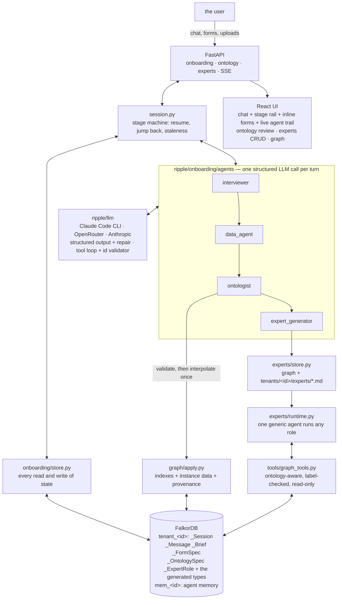

# Ripple: it interviews your company and builds the graph

> **Graph Hacks: Context for AI Agents** (WeMakeDevs × FalkorDB), Oct 15–18, 2026.
> **Tracks entered: 01 (Agents That Act on Connected Data), 02 (Agent Memory and Coordination), 03 (Company Brain).**

Most graph demos ship with a schema. Ripple ships with none. A company arrives at an empty FalkorDB, and four
agents turn *"we make shoes"* into a running knowledge-graph application: they interview the business, work out
what data is needed and ask for it as forms in the chat, design the ontology and load the company's data against
it, and then **invent the expert agents that this particular supply chain needs** — writing each one's system
prompt, justifying it against the ontology it reasons over, and running it as a real agent over the graph.

Nothing is hard-wired. There is no DataCo, no shipped ontology, no fallback script. Every agent step is a real
LLM call, and **FalkorDB is the only hard dependency**: the onboarding state, the generated ontology, the
company's instance data, the expert roles and all agent memory live in it.

```
"we make shoes"  ─►  Interviewer  ─►  Data agent  ─►  Ontology agent  ─►  Expert generator  ─►  a live app
                     a brief          a data pack     a graph + data      agents that answer
```

## The four agents

| # | Agent | Role | Produces | Approved by |
|---|---|---|---|---|
| 1 | **Interviewer** | A product manager who is also a supply chain expert. Keeps a private checklist of its own open doubts and works it down, so the interview's length scales with how complicated the business is. | A structured **Supply Chain Brief** | the agent, gated by a core-topic guard |
| 2 | **Data agent** | Decides what data would make the brief concrete and asks for it as **forms inside the chat** — iterative, narrowing, round by round. Never invents a value. | A **Data Pack**: answers, uploaded tables, documents | the agent |
| 3 | **Ontology agent** | Designs the tenant's graph model from the brief and the data pack, then loads the data against it with provenance. | An **Ontology Spec** + a populated graph | **you**, in the UI |
| 4 | **Expert generator** | Invents the expert roles this supply chain needs, justifies each against the ontology, and writes its full system prompt. | **Expert Roles**, each a real runtime agent | **you**, role by role |

Onboarding is **non-linear**: you can jump back to any stage you have reached, and every downstream artifact is
flagged stale and re-derived. Everything persists in FalkorDB as it happens, so closing the browser mid-answer
loses nothing — including a turn that was in flight when the process died.

## What a judge sees (3 acts, ~4 minutes)

1. **Act 1 — nothing up our sleeve (Track 01).** Start with an empty database: `/api/health` shows no graphs.
   Type a company name. The interviewer asks five questions, not fifty, and its private checklist appears in the
   live agent trail on the right. Answer three turns, upload a `suppliers.csv`, and watch the brief fill in on
   the right-hand panel — the upload is profiled (columns, dtypes, null rates, five sample rows) and only the
   profile reaches the agent's context. The data agent then asks for exactly what is missing as a form with a
   repeating supplier table; press **Synthesize** and every value comes back badged `synthetic`, because a demo
   should not need your real numbers to be honest about which ones they are.
2. **Act 2 — the model is yours (Track 01 + 03).** The ontology agent drafts the spec and the diagram renders
   from it: your types, your words, with lead time on the `SUPPLIES` edge where it belongs. Rename a type in the
   table or ask the agent in chat to merge two — it returns the whole revised spec and the version history grows.
   Approve: indexes are created, the data pack is read into the approved types, and clicking any node answers
   **"where did this number come from?"** from the graph — back to the exact form field or uploaded column.
3. **Act 3 — agents that did not exist an hour ago (Tracks 01 + 02).** The expert generator proposes the roles
   *this* chain needs, each with an ontology-grounded justification; a role whose focus types are not in the spec
   is rejected and the agent is told to drop or merge it. Approve them, then ask one a question. It calls
   `describe_ontology` (it does not know your labels in advance either), walks the graph, and answers citing node
   ids that an **id validator** has checked against what the tools actually returned. Its prompt is in the graph
   *and* at `tenants/<id>/experts/<name>.md`, so you can review it in git, edit it in a text editor, and import
   it back.

Terminal walk-through of the same three acts: `.venv/bin/python scripts/demo.py --company "Northwind Trainers"`.

## Architecture



### The ideas worth stealing

* **The ontology is data, not code.** A per-tenant model means Cypher cannot parameterise a label, so every
  generated label passes `validate_spec` and then exactly one guarded interpolation point
  (`graph/queries.ident`, regex `^[A-Za-z][A-Za-z0-9_]{0,63}$`). The query *text* still lives in
  `graph/queries/*.cypher` as `kind: template`, so the house rule survives a dynamic schema.
* **The agent's checklist is its working memory.** The interviewer and the data agent emit
  `add`/`resolve`/`revise`/`drop` operations on a private checklist, persisted as `_ChecklistItem` nodes. It
  stops repetition, it makes the interview end when the business is understood rather than after N questions,
  and `open` count is the progress signal the stage machine reads.
* **An agent decides it is finished; the host decides whether it may be.** The interviewer sets `done: true`;
  the stage machine refuses while `Brief.core_gaps()` is non-empty and reopens a checklist item instead. The
  model is in charge of the conversation, the code is in charge of the invariant.
* **Validation is a conversation, not an exception.** An invalid spec or an ungrounded expert role goes back to
  the agent with the list of errors, up to twice, before the user ever sees it.
* **Never invent data.** The data agent must ask for a ballpark rather than fill a number in, and every answer
  carries `source` and `confidence` — which are carried onto the loaded nodes, so an expert can say *"this rests
  on a ballpark"*. `Synthesize` is a separate, explicitly demo-only pass that flags the whole tenant.
* **Provenance is an edge, not a log line.** Every generated node has `HAS_PROVENANCE → _Provenance → FROM_SOURCE
  → _FormAnswer | _Attachment`, so *"where did this come from?"* is one Cypher query.
* **No fakes.** There is no scripted mode and no `FakeLLM` to hide behind: the suite is split into
  164 deterministic tests (no network) and a live half under `-m llm` whose transcripts are recorded.

## Run it

```bash
bash scripts/setup_env.sh                  # offline from vendor/
.venv/bin/uvicorn ripple.api.app:app       # the API owns the embedded FalkorDB
cd ui && npm run dev                       # http://localhost:5173
```

The default LLM provider is **Claude Code on your own login** — no API key: Ripple shells out to `claude -p`
with its own tools off. Set `RIPPLE_LLM_PROVIDER=openrouter` + `OPENROUTER_API_KEY`, or `anthropic` +
`ANTHROPIC_API_KEY`, to use an API instead. See `.env.example`.

```bash
.venv/bin/pytest -q                        # 164 deterministic tests, no network
.venv/bin/pytest -q -m llm                 # the live half: real agent calls, recorded
cd ui && npm run build                     # typecheck + bundle
docker compose up                          # FalkorDB + API + UI in one stack
```

## The agents' prompts

The prompts are the product. They are versioned in git, read at call time, and nothing in the code paraphrases
them.

| Prompt | Words | Opens with |
|---|---|---|
| [`data_agent`](ripple/onboarding/agents/prompts/data_agent.md) | 649 | You are the Ripple data agent. The interviewer has handed you a Supply Chain Brief: a readable description |
| [`expert_generator`](ripple/onboarding/agents/prompts/expert_generator.md) | 468 | You are the Ripple expert generator. You decide which expert agents this particular company needs, and you |
| [`interviewer`](ripple/onboarding/agents/prompts/interviewer.md) | 672 | You are the Ripple interviewer: a product manager who is also a supply chain expert. You are talking to |
| [`ontologist`](ripple/onboarding/agents/prompts/ontologist.md) | 570 | You are the Ripple ontology agent. You design the graph model for one company's supply chain, from the |
| [`synthesize`](ripple/onboarding/agents/prompts/synthesize.md) | 230 | You are filling in a demo form with plausible made-up values. |

## The artifact models

These pydantic models are the contract in three directions at once: the JSON schema sent to the model, the
validation of what comes back, and the shape the UI reads.

| Model | Produced by | Fields |
|---|---|---|
| [`Brief`](ripple/onboarding/models.py#L75) | the interviewer | `company`, `industry`, `summary`, `products`, `components`, `suppliers`, `sites`, `manufacturing`, `transport_modes`, `warehousing`, `distribution`, `customers`, `markets`, `commercial`, `constraints`, `risks`, `pains`, `vocabulary`, `unknowns`, `scale` |
| [`InterviewTurn`](ripple/onboarding/models.py#L179) | the interviewer | `reply`, `checklist_ops`, `brief_patch`, `ask_for_files`, `done`, `done_reason` |
| [`FormSpec`](ripple/onboarding/models.py#L247) | the data agent | `id`, `round`, `title`, `intro`, `fields`, `status`, `ts` |
| [`DataTurn`](ripple/onboarding/models.py#L268) | the data agent | `reply`, `form`, `checklist_ops`, `ask_for_files`, `file_mappings`, `done`, `done_reason` |
| [`FormAnswer`](ripple/onboarding/models.py#L293) | the user (or Synthesize) | `id`, `form_id`, `field_id`, `value`, `source`, `confidence`, `ts` |
| [`OntologySpec`](ripple/onboarding/models.py#L357) | the ontology agent | `version`, `types`, `relationships`, `indexes`, `rationale`, `coverage` |
| [`OntologyTurn`](ripple/onboarding/models.py#L387) | the ontology agent | `reply`, `spec`, `questions` |
| [`InstanceBatch`](ripple/onboarding/models.py#L395) | the ontology agent | `nodes`, `edges`, `notes` |
| [`ExpertRole`](ripple/onboarding/models.py#L405) | the expert generator (or the user) | `id`, `name`, `title`, `mandate`, `justification`, `focus_types`, `focus_relationships`, `playbook`, `tools`, `system_prompt`, `status`, `version`, `origin`, `stale`, `ts` |
| [`ExpertsTurn`](ripple/onboarding/models.py#L429) | the expert generator | `reply`, `roles`, `dropped` |

## The expert runtime's tools (6)

None of them knows a label in advance. Every one takes a type from the tenant's *approved* spec and is rejected
if it names anything else, which is how one tool set works for every generated ontology.

| Tool | Kind | What it does |
|---|---|---|
| `describe_ontology` | read | This tenant's approved ontology: node types with their properties and instance counts, and the relationships between them. Call this first - the ontology is different for every company. |
| `find_nodes` | read | Nodes of one type, optionally filtered by a substring of their title property or id. |
| `get_node` | read | Every property of one node, by type and id. |
| `neighbours` | read | One node's immediate neighbours, grouped by the relationship that reaches them and its direction. |
| `aggregate` | read | count/sum/avg/min/max of a numeric property of a type, or node counts grouped by a property. |
| `provenance` | read | Where a node's values came from: the onboarding form answers and uploaded files behind it. |

## The graph

### Platform labels (`_`-prefixed, so a generated label can never collide)

| Label | What it holds |
|---|---|
| `_Tenant` | the company: `id`, `name`, `stage`, `status`, `has_synthetic` |
| `_Session` | the onboarding cursor: `stage`, `provider`, `model`, `pending_json` (the turn in flight) |
| `_Message` | every chat turn, with `kind` = `text` / `form` / `attachment` / `system` / `artifact` |
| `_ChecklistItem` | an agent's private open doubts, per stage |
| `_Attachment` | an upload: `sha256`, `kind`, `profile_json`, `summary` |
| `_Brief` | the Supply Chain Brief, versioned, never overwritten |
| `_FormSpec` / `_FormAnswer` | a form round and its per-field answers, with `source` and `confidence` |
| `_OntologySpec` / `_OntologyType` | the generated model, versioned, with `status` `draft`/`approved`/`superseded` |
| `_ExpertRole` | a role: mandate, justification, focus, playbook and its full system prompt |
| `_AgentStep` / `_ToolCall` | the audit and stream trail |
| `_Provenance` | the bridge from a loaded node back to the answer or upload it came from |

Edges: `(_Session)-[:HAS_MESSAGE]->(_Message)`, `(_FormSpec)-[:HAS_ANSWER]->(_FormAnswer)`,
`(_Brief|_OntologySpec)-[:DERIVED_FROM]->(_Message|_FormAnswer|_Attachment)`,
`(_OntologySpec)-[:DEFINES]->(_OntologyType)`, `(_ExpertRole)-[:FOCUSES_ON]->(_OntologyType)`,
`(node)-[:HAS_PROVENANCE]->(_Provenance)-[:FROM_SOURCE]->(_FormAnswer|_Attachment)`.

### Every query (59 files)

Every query Ripple runs lives in `graph/queries/*.cypher` with a header the docs are generated from. The ones
marked `template` carry `{placeholders}` filled from the approved spec — that is how a per-tenant ontology is
queried without string-building Cypher in Python.

### Key queries

**messages_list** — resume: Every message of a session in order, optionally after a sequence number

```cypher
MATCH (:_Session {id: $sid})-[:HAS_MESSAGE]->(m:_Message)
WHERE m.seq > $after
RETURN m.id AS id, m.role AS role, m.agent AS agent, m.stage AS stage, m.kind AS kind, m.text AS text,
       m.payload_json AS payload_json, m.ts AS ts, m.seq AS seq
ORDER BY m.seq
```

**session_get** — the stage cursor: The most recent onboarding session

```cypher
MATCH (s:_Session)
RETURN s.id AS id, s.stage AS stage, s.started_at AS started_at, s.updated_at AS updated_at,
       s.provider AS provider, s.model AS model, s.pending_json AS pending_json
ORDER BY s.started_at DESC
LIMIT 1
```

**ontology_versions** — artifact history: Every ontology spec version, newest first

```cypher
MATCH (o:_OntologySpec)
RETURN o.id AS id, o.version AS version, o.status AS status, o.stale AS stale, o.ts AS ts
ORDER BY o.version DESC
```

**artifacts_mark_stale** — staleness: Flag every artifact of these labels stale (downstream of a changed upstream artifact)

```cypher
MATCH (n)
WHERE any(l IN labels(n) WHERE l IN $labels)
SET n.stale = true
RETURN count(n) AS flagged
```

**instance_merge_nodes** — loading a generated type (template: `{...}` is filled from the approved spec): Load instance rows as nodes of one generated type. Template: {label} comes from the approved spec.

```cypher
UNWIND $rows AS r
MERGE (n:{label} {{id: r.id}})
SET n += r
RETURN count(n) AS merged
```

**instance_merge_edges** — loading a generated relationship (template: `{...}` is filled from the approved spec): Load instance rows as edges of one generated relationship type. Template: {rel}, {from_label}, {to_label}.

```cypher
UNWIND $rows AS r
MATCH (a:{from_label} {{id: r.from}})
MATCH (b:{to_label} {{id: r.to}})
MERGE (a)-[e:{rel}]->(b)
SET e += r.props
RETURN count(e) AS merged
```

**provenance_of** — where did this come from: Where did this number come from? The answers and uploads behind one instance node

```cypher
MATCH (n {id: $id})-[:HAS_PROVENANCE]->(p:_Provenance)-[:FROM_SOURCE]->(src)
RETURN n.id AS node_id, labels(src)[0] AS source_label, src.id AS source_id,
       coalesce(src.field_id, src.filename, '') AS source_ref,
       coalesce(src.value_json, src.summary, '') AS source_value, p.source AS source, p.confidence AS confidence
ORDER BY source_id
```

**neighbourhood** — one node's neighbourhood (template: `{...}` is filled from the approved spec): One node's immediate neighbours and the edge types that reach them. Template: {label}.

```cypher
MATCH (n:{label} {{id: $id}})-[r]-(m)
WHERE NOT any(l IN labels(m) WHERE l STARTS WITH '_')
RETURN type(r) AS rel, startNode(r).id = n.id AS outgoing, labels(m)[0] AS label, m.id AS id,
       coalesce(m.name, m.title, m.id) AS title
ORDER BY rel, id
LIMIT $limit
```

### All 59 query files

#### Onboarding state

| File | Kind | Graph | Purpose |
|---|---|---|---|
| [`attachment_get`](graph/queries/attachment_get.cypher) | read | ops | One upload by id |
| [`attachment_upsert`](graph/queries/attachment_upsert.cypher) | write | ops | Record an upload with its profile |
| [`checklist_list`](graph/queries/checklist_list.cypher) | read | ops | A stage's checklist items (the agent's working memory; never rendered to the user) |
| [`checklist_upsert`](graph/queries/checklist_upsert.cypher) | write | ops | Create or update one internal checklist item of a stage agent |
| [`message_append`](graph/queries/message_append.cypher) | write | ops | Append one chat message to a session |
| [`message_max_seq`](graph/queries/message_max_seq.cypher) | read | ops | The highest message sequence number in a session (0 when empty) |
| [`session_get`](graph/queries/session_get.cypher) | read | ops | The most recent onboarding session |
| [`session_set`](graph/queries/session_set.cypher) | write | ops | Patch session fields (stage, updated_at, pending_json) |
| [`session_upsert`](graph/queries/session_upsert.cypher) | write | ops | Create or update the onboarding session (stage cursor, provider, model) |
| [`step_append`](graph/queries/step_append.cypher) | write | ops | Record one agent step (the audit and stream trail) |
| [`steps_list`](graph/queries/steps_list.cypher) | read | ops | Agent steps in order, newest last (optionally one stage) |
| [`tenant_counts`](graph/queries/tenant_counts.cypher) | read | ops | Node and edge totals of a graph |
| [`tenant_get`](graph/queries/tenant_get.cypher) | read | ops | The tenant node (id, name, stage, status, flags) |
| [`tenant_set`](graph/queries/tenant_set.cypher) | write | ops | Patch tenant fields (stage, status, has_synthetic, name) |
| [`tenant_upsert`](graph/queries/tenant_upsert.cypher) | write | ops | Create or update the tenant node that owns this graph |

#### Artifacts and versioning

| File | Kind | Graph | Purpose |
|---|---|---|---|
| [`answer_upsert`](graph/queries/answer_upsert.cypher) | write | ops | Save one form answer (per-field autosave); re-saving a field overwrites it |
| [`answers_list`](graph/queries/answers_list.cypher) | read | ops | Every answer of the data pack (optionally one form round) |
| [`artifacts_mark_stale`](graph/queries/artifacts_mark_stale.cypher) | write | ops | Flag every artifact of these labels stale (downstream of a changed upstream artifact) |
| [`brief_current`](graph/queries/brief_current.cypher) | read | ops | The latest brief version |
| [`brief_upsert`](graph/queries/brief_upsert.cypher) | write | ops | Store a new version of the Supply Chain Brief (versions are never overwritten) |
| [`brief_versions`](graph/queries/brief_versions.cypher) | read | ops | Every brief version, newest first (artifact history) |
| [`derived_from`](graph/queries/derived_from.cypher) | write | ops | Record that an artifact was derived from the messages, answers and uploads listed |
| [`expert_delete`](graph/queries/expert_delete.cypher) | write | ops | Delete an expert role and its edges |
| [`expert_focus_link`](graph/queries/expert_focus_link.cypher) | write | ops | Link an expert role to the ontology types it reasons over |
| [`expert_get`](graph/queries/expert_get.cypher) | read | ops | One expert role by id |
| [`expert_set_status`](graph/queries/expert_set_status.cypher) | write | ops | Approve / retire / redraft one expert role |
| [`expert_upsert`](graph/queries/expert_upsert.cypher) | write | ops | Create or update an expert role (generated or user-authored) |
| [`experts_list`](graph/queries/experts_list.cypher) | read | ops | Every expert role, newest first |
| [`formspec_get`](graph/queries/formspec_get.cypher) | read | ops | One form round by id |
| [`formspec_set_status`](graph/queries/formspec_set_status.cypher) | write | ops | Mark a form round open or submitted |
| [`formspec_upsert`](graph/queries/formspec_upsert.cypher) | write | ops | Store one round of the data agent's in-chat form |
| [`formspecs_list`](graph/queries/formspecs_list.cypher) | read | ops | Every form round in order |
| [`ontology_approved`](graph/queries/ontology_approved.cypher) | read | ops | The approved ontology spec the instance data is loaded against |
| [`ontology_current`](graph/queries/ontology_current.cypher) | read | ops | The latest ontology spec of any status |
| [`ontology_set_status`](graph/queries/ontology_set_status.cypher) | write | ops | Approve / supersede one ontology spec version |
| [`ontology_supersede_others`](graph/queries/ontology_supersede_others.cypher) | write | ops | Mark every approved spec other than this one superseded |
| [`ontology_types_list`](graph/queries/ontology_types_list.cypher) | read | ops | The declared types of one spec |
| [`ontology_types_upsert`](graph/queries/ontology_types_upsert.cypher) | write | ops | One _OntologyType node per label of a spec, so experts can FOCUSES_ON them |
| [`ontology_upsert`](graph/queries/ontology_upsert.cypher) | write | ops | Store a new version of the generated ontology spec |
| [`ontology_versions`](graph/queries/ontology_versions.cypher) | read | ops | Every ontology spec version, newest first |

#### The generated ontology (templates)

| File | Kind | Graph | Purpose |
|---|---|---|---|
| [`aggregate_property`](graph/queries/aggregate_property.cypher) | template | ops | count / sum / avg / min / max of one property of one generated type. Template: {label}, {prop}. |
| [`group_by_property`](graph/queries/group_by_property.cypher) | template | ops | Count nodes of one generated type grouped by a property. Template: {label}, {prop}. |
| [`instance_counts`](graph/queries/instance_counts.cypher) | read | ops | Instance node counts per generated label (platform labels excluded) |
| [`instance_edge_counts`](graph/queries/instance_edge_counts.cypher) | read | ops | Instance edge counts per generated relationship type (platform edges excluded) |
| [`instance_merge_edges`](graph/queries/instance_merge_edges.cypher) | template | ops | Load instance rows as edges of one generated relationship type. Template: {rel}, {from_label}, {to_label}. |
| [`instance_merge_nodes`](graph/queries/instance_merge_nodes.cypher) | template | ops | Load instance rows as nodes of one generated type. Template: {label} comes from the approved spec. |
| [`instance_wipe`](graph/queries/instance_wipe.cypher) | write | ops | Delete every instance node of the generated ontology (re-load after a new approved spec) |
| [`neighbourhood`](graph/queries/neighbourhood.cypher) | template | ops | One node's immediate neighbours and the edge types that reach them. Template: {label}. |
| [`node_lookup`](graph/queries/node_lookup.cypher) | template | ops | One node of a generated type by id, with every property. Template: {label}. |
| [`nodes_of_type`](graph/queries/nodes_of_type.cypher) | template | ops | Nodes of one generated type (paged). Template: {label}. |
| [`provenance_link`](graph/queries/provenance_link.cypher) | write | ops | Link generated instance nodes back to the form answers and uploads they came from |
| [`provenance_of`](graph/queries/provenance_of.cypher) | read | ops | Where did this number come from? The answers and uploads behind one instance node |
| [`provenance_wipe`](graph/queries/provenance_wipe.cypher) | write | ops | Delete provenance nodes whose instance node is gone (after an instance wipe) |
| [`search_nodes`](graph/queries/search_nodes.cypher) | template | ops | Case-insensitive substring search over the title property of one generated type. Template: {label}, {prop}. |

#### Platform

| File | Kind | Graph | Purpose |
|---|---|---|---|
| [`meta_stats`](graph/queries/meta_stats.cypher) | read | ops | Label and relationship-type counts (db.meta.stats) for the ontology page |
| [`tool_call_log`](graph/queries/tool_call_log.cypher) | write | ops | Record one tool call so an expert's answer can be traced back to the queries behind it |
| [`tool_calls_list`](graph/queries/tool_calls_list.cypher) | read | ops | Recent tool calls (newest first) |

#### Other

| File | Kind | Purpose |
|---|---|---|
| [`attachments_list`](graph/queries/attachments_list.cypher) | read | Every upload of this tenant with its profile |
| [`messages_list`](graph/queries/messages_list.cypher) | read | Every message of a session in order, optionally after a sequence number |

## Measured numbers

_Generated by `scripts/report_numbers.py` on 2026-10-15 (3.12.3 on x86_64)._

### The platform

| | |
|---|---|
| Query files (`graph/queries/*.cypher`) | 59 |
| Tools in the registry | 6 |
| Agent prompts | 5 files, 2,589 words |
| Python | 42 files, 4,795 lines |
| UI | 16 files, 2,541 lines |
| Deterministic suite | 178 tests in 15.7s |

### One tenant's graph (12 generated types, 500 instances each)

| | |
|---|---|
| Tenant create + platform indexes | 15.0 ms |
| Apply the generated spec (24 indexes) | 8.6 ms |
| Load 6,000 nodes + 5,500 edges | 311.1 ms (19,286 nodes/s) |
| Graph on disk | 0.4 MB |

### Tool latency (20 runs each)

| Tool | p50 | p95 |
|---|---|---|
| `describe_ontology` | 40.0 ms | 62.5 ms |
| `find_nodes` | 3.8 ms | 5.5 ms |
| `get_node` | 2.25 ms | 2.6 ms |
| `neighbours` | 2.35 ms | 3.9 ms |
| `aggregate` | 2.1 ms | 2.6 ms |

## FalkorDB notes

`reference/FALKORDB_VERIFIED.md` records what was verified by running it (embedded `falkordblite` 0.10.0, graph
module v4.18.3). The ones this build turns on:

* **Map-valued properties are rejected.** Instance properties are flattened one level and anything deeper is
  JSON-encoded (`graph/apply.py:_flat`).
* **`MERGE` on an unlabelled pattern scans the graph.** Loading edges grouped by `(relationship, from label, to
  label)` so both `MATCH`es hit an id index made the instance load **~50× faster** (16.3 s → 0.33 s for 11.5k
  entities).
* **Re-running `CREATE INDEX` raises.** Both the platform schema and `apply_spec` treat "already exists" as
  success, so approving an ontology twice is safe.
* **One process owns an embedded `.db` file.** The API process owns it; everything else goes through the HTTP
  API or runs in-process.

Known limits and workarounds: [`docs/KNOWN_ISSUES.md`](docs/KNOWN_ISSUES.md).

## What is deliberately not here yet

The post-onboarding application. v1 built a control tower (incidents, blast radius, actions, playbooks,
company brain) on a fixed ontology; all of that is archived rather than reused, because on a *generated*
ontology the shape of an incident, an action and a playbook is a design question, not a port. `plan.md` §10 is
where it picks up; the expert runtime's read-only tool set is the deliberate minimum that proves a generated
role is alive.

## Licence and provenance

MIT, see [LICENCE](LICENSE). AI-assisted build: [`AI_DISCLOSURE.md`](AI_DISCLOSURE.md). The build plan and its
milestones: [`plan.md`](plan.md); the original pitch: [`idea.md`](idea.md); v1's plan, for the record:
[`docs/plan_v1_dataco.md`](docs/plan_v1_dataco.md).
