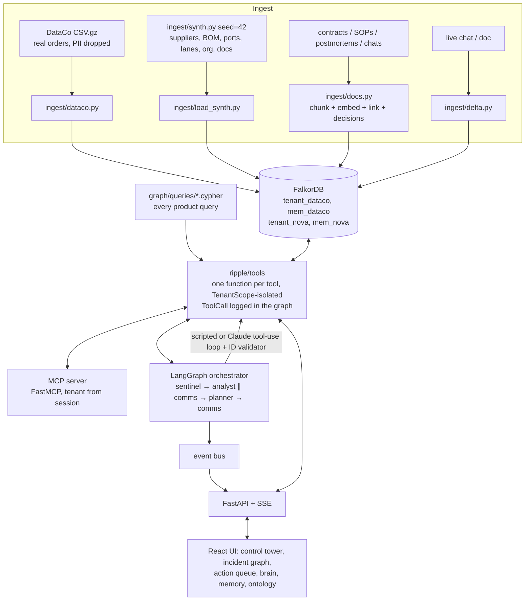

# Ripple: a graph-native supply chain control tower on FalkorDB

> **Graph Hacks: Context for AI Agents** (WeMakeDevs x FalkorDB), Oct 15-18, 2026.
> **Tracks entered: 01 (Agents That Act on Connected Data), 02 (Agent Memory and Coordination), 03 (Company Brain).**

A port closes, a tier-2 supplier burns, a carrier strikes. Ripple's four agents (Sentinel, Impact Analyst, Planner,
Comms) work on a Palantir-style **ontology stored in FalkorDB**: they trace the blast radius from the disruption to
the customer orders it hits and put a revenue figure on it, propose and execute mitigations that are written back
to the graph as auditable `Action`s, remember what happened last time (across restarts, per tenant), and answer
"who owns / why did we / what does the contract say" with sources. Every answer carries the node ids and edges of
the graph path that produced it.


| | |
|---|---|
|  |  |

## What a judge sees (3 acts, ~3.5 minutes)

1. **Act 1 (Track 01).** Trigger *Port of Shanghai closure*. Sentinel matches it to `PORT-CNSHA`, opens an
   incident and recalls a similar past episode. The Analyst walks
   `Disruption→Port←Lane←Order→OrderLine→Product←Part←Supplier` and finds the open orders, revenue and customers at
   risk (exactly equal to an independent pandas ground truth). Betweenness centrality flags chokepoints. The
   Planner follows the best playbook, runs weighted shortest paths around the closed port, proposes a reroute and
   notifies the relationship owner. A human approves; the reroute re-points `SHIPS_VIA` edges and **revenue at risk
   drops to $0**. The evidence drawer shows every node the action is `BASED_ON`.
2. **Act 2 (Track 02).** Close the incident (episode + playbook stats + temporal facts are written to the
   tenant's memory graph). Restart the process. Trigger *Ningbo port congestion*: Sentinel recalls the Shanghai
   episode from the previous session and the Planner reuses its playbook. Switch tenant to *Nova Retail*: different
   graphs, disjoint ids. The load test runs 20 concurrent sessions over both tenants with zero leaks and zero
   duplicate actions.
3. **Act 3 (Track 03).** Ask the company brain the five demo questions; each answer has source chips (contract,
   postmortem, chat thread, SOP) and a path. Post a chat message handing the Shenzhen Volt relationship to a new
   owner; ask again and the answer changes, citing the new message.

Terminal fallback of the same three acts: `.venv/bin/python scripts/demo.py`.

## Architecture



* **One implementation of every capability**: tools are plain Python functions `fn(scope, **args) -> ToolResult`
  (`data`, `node_ids`, `edges`, `queries`, `ms`). The MCP server, the agents, the API and the tests all call them.
* **Isolation in code**: a `TenantScope` can open only `tenant_<id>` and `mem_<id>`; MCP tool schemas have no
  tenant argument (the tenant comes from the session).
* **The Incident node is the blackboard**: LangGraph state holds only ids; agents read and write the graph and record
  `(:Agent)-[:HANDED_OFF_TO {incident_id, ts, summary}]->(:Agent)`. Writes are idempotent `MERGE`s on deterministic
  ids (`INC-`/`ACT-`/`EPI-` hashes), so re-runs and concurrent duplicates never create duplicates.
* **Two agent modes**: deterministic *scripted* (default, no key needed) and *LLM* (Claude, `claude-opus-5-5`, manual
  tool-use loop over the same registry tools). An **ID validator** rejects any answer that cites an id no tool
  returned; after one failed fix the agent falls back to its scripted logic.

## Why a graph (no FalkorDB, no product)

| Capability | What FalkorDB does | Without it |
|---|---|---|
| Blast radius | 5-7 hop traversals Disruption→Port←Lane←Order→OrderLine→Product←Part←Supplier, recomputed live after every action | 5-8 joins across ERP/TMS tables per question, stale after any change |
| Supplier failure | `SUPPLIES_TO*0..2` upstream expansion + "all active suppliers affected" check per part | recursive CTEs over three tiers |
| Chokepoints | `algo.betweenness`, `algo.pageRank`, `algo.WCC`, `algo.labelPropagation` on the supplier network | no hidden tier-2 chokepoint detection |
| Rerouting | `algo.SPpaths` weighted k-shortest paths over `CONNECTS`, filtered to avoid closed ports | hand-maintained routing tables |
| Actions | executing an action re-points `SHIPS_VIA` or turns `QUALIFIED_FOR` into `SUPPLIES`; revenue at risk drops because the traversal changes | a separate state machine with no link to the impact model |
| Company brain | vector index on chunks + `MENTIONS`/`ABOUT`/`SOURCED_FROM`/`OWNS_RELATIONSHIP` expansion | plain RAG: fragments, no owners, no decisions, no "why" |
| Memory | episodes, playbooks and temporal facts as nodes in a per-tenant memory graph that survives restarts | prompts that forget |

Every agent answer is a Cypher query or a graph algorithm call; the tool trace is visible in the UI timeline and as
`(:Incident)-[:HAS_CALL]->(:ToolCall)` in the graph.

## Graph data model (ontology)

{{ONTOLOGY}}

## Cypher queries and graph algorithms

Every query the product runs lives in [`graph/queries/`](graph/queries) (one file each, with a header: name,
purpose, kind, example params) and is loaded by name (`ripple/graph/queries.py`). This section is generated from
those headers by `scripts/build_docs.py`, so the README and the code cannot drift apart. `tests/test_queries.py`
runs every file with its example params.

{{QUERIES}}

### Algorithms used

| Algorithm | FalkorDB procedure | Used for |
|---|---|---|
| Betweenness centrality (exact: `samplingSize` above the node count, fixed seed) | `algo.betweenness` | `single_points_of_failure`: the 3 planted tier-2 chokepoints rank top 3 |
| PageRank | `algo.pageRank` | `supplier_influence` |
| Weakly connected components | `algo.WCC` | `supplier_clusters` (correlated risk) |
| Label propagation (CDLP) | `algo.labelPropagation` | `supplier_clusters` communities |
| Weighted k-shortest paths | `algo.SPpaths` (weight `transit_days`) | `alt_route`, avoiding closed ports |
| Unweighted shortest path (fallback) | `shortestPath` inside `WITH` | `alt_route` fallback |
| Vector search (cosine; `score` is a distance) | `db.idx.vector.queryNodes`, `vec.cosineDistance` | `doc_search`, `contract_terms`, `recall_similar_episodes` |

## Agents, tools, memory, brain

| Agent | Scripted steps (each one a tool call, streamed to the UI) |
|---|---|
| Sentinel | `match_event_to_entities` → `create_disruption` → `open_incident` → `recall_similar_episodes` |
| Impact Analyst | `blast_radius` → `revenue_at_risk` → `customer_exposure` → `late_risk_baseline` → `single_points_of_failure` |
| Comms (prefetch, parallel with the Analyst) | `who_owns` for related suppliers → `contract_terms` → `who_knows` |
| Planner | `get_playbook` → per step: `plan_reroute` (uses `alt_route`) / `plan_alt_suppliers` (uses `alt_suppliers`) → `propose_action` → auto-execute per policy (`execute_action`) → `revenue_at_risk` |
| Comms | `draft_notification` per action → `contract_terms` with the incident (penalty owed, force-majeure aware) → summary |
| Close | `record_episode` (outcome from revenue before/after, playbook uses/successes) → `upsert_fact` → risk feedback → `SAVE` |

* **Auto-approval policy**: `NOTIFY_OWNER` and `PLACE_HOLD` execute immediately; `REROUTE_ORDERS` executes on its own
  only if it adds ≤3 days and moves ≤50 orders; everything else waits for a human in the Action Queue
  (`APPROVED_BY` edge). Every executed action stores its before-state; **undo** restores it and records a
  `REVERSES` action.
* **Memory (per tenant, `mem_<id>`)**: episodic (`Episode`, recall score = 0.5·same type + 0.3·Jaccard of entities and
  countries + 0.2·vector similarity), procedural (`Playbook` with success rate), semantic (`Fact` with
  `valid_at`/`invalid_at`, contradictions `SUPERSEDES`), conversation (`User`/`Conversation`/`ConvMessage`).
* **Company brain**: intents *owner, why, contract, expertise, change* plus doc-search fallback; entities resolved
  with the same dictionary used for entity linking at ingest. Answer contract:
  `{answer, sources: [{doc_id, title, uri, chunk_id, snippet}], path: [node ids], edges, intent}`.
* **MCP**: `python -m ripple.mcp_server --tenant dataco` exposes all {{N_TOOLS}} tools over stdio, plus resources
  `ripple://ontology` and `ripple://incident/{id}`.

## Setup

**Quickstart (embedded FalkorDB, no server, no keys):**

```bash
bash scripts/setup_env.sh                       # Python 3.12/3.13 venv + UI deps; offline from vendor/ on Linux x86_64
.venv/bin/python -m ripple.ingest.build         # builds both tenants into var/ripple.db (full DataCo: ~30 s)
.venv/bin/uvicorn ripple.api.app:app --port 8000   # API (+ the UI if ui/dist exists)
cd ui && npm run build                          # or `npm run dev` on :5173 with the API proxied
```

The API builds missing tenants on startup (`RIPPLE_AUTOBUILD=1`; set `RIPPLE_SAMPLE_ORDERS=3000` for a fast
sample). One process owns an embedded `.db` file: run tools, agents and the MCP server in-process or through the API.

**Docker (FalkorDB server + Browser on :3000, API in remote mode):** `cp .env.example .env`, set
`FALKORDB_PASSWORD` (FalkorDB runs with `--requirepass`; compose refuses to start without it), then
`docker compose up --build` and open http://localhost:8000 (Ripple) and http://localhost:3000 (FalkorDB Browser:
host `localhost`, port `6379`, user `default`, that password).

**FalkorDB Cloud:** set `RIPPLE_DB_MODE=remote`, `FALKORDB_HOST`, `FALKORDB_PORT`, `FALKORDB_USERNAME`,
`FALKORDB_PASSWORD`, then `python -m ripple.ingest.build` and start the API. `render.yaml` deploys the single
container.

**Claude agents via OpenRouter:** set `OPENROUTER_API_KEY` (model `OPENROUTER_MODEL`, default
`anthropic/claude-opus-5.5`) and pick "Claude agents" next to the scenarios. `ANTHROPIC_API_KEY` (model
`RIPPLE_MODEL`, default `claude-opus-5-5`) also works; `RIPPLE_LLM_PROVIDER=auto` prefers OpenRouter. Without a
key the UI reports `scripted (no API key)` and runs scripted agents.

**Claude agents via Claude Code (no API key):** `RIPPLE_LLM_PROVIDER=claude_code` runs each agent turn as a
headless `claude -p` call on this machine's Claude Code login (its own tools and MCP servers off; Ripple's tools
are offered through structured output and still run, logged and validated, inside Ripple). Model:
`CLAUDE_CODE_MODEL` (default `opus`). With the API on the host, nothing else is needed. With `docker compose`, start
the host bridge first: `.venv/bin/python -m ripple.claude_code_bridge` (127.0.0.1:8765; the container reaches it at
`host.docker.internal`; set `CLAUDE_CODE_BRIDGE_TOKEN` in `.env` to require a token). Claude has no embedding
model, so keep `RIPPLE_EMBEDDINGS=hash` (local) for a setup with no API keys at all.

**Embeddings via OpenRouter:** `RIPPLE_EMBEDDINGS=openrouter` embeds chunks, messages and episodes with
`OPENROUTER_EMBED_MODEL` (default `openai/text-embedding-3-small`, 1536-d; the dimension is probed unless
`RIPPLE_EMBED_DIM` is set). The vector indexes take that dimension, so rebuild after switching
(`python -m ripple.ingest.build`, or `docker compose down -v` first). The default `hash` embedder is offline.

**MCP (Claude Desktop or any MCP client)**, against a FalkorDB server:

```json
{"mcpServers": {"ripple": {"command": "/path/to/repo/.venv/bin/python",
  "args": ["-m", "ripple.mcp_server", "--tenant", "dataco"],
  "env": {"RIPPLE_DB_MODE": "remote", "FALKORDB_HOST": "localhost"}}}}
```

**Tests:** `.venv/bin/pytest -q` (sampled data, ~1.5 min), `.venv/bin/pytest -m slow` (full dataset),
`RIPPLE_DB_MODE=remote .venv/bin/pytest -q` (against a FalkorDB server). Evals: `eval/run_scenarios.py --full`,
`eval/run_brain_eval.py`, `eval/load_test.py`. All numbers below: `scripts/report_numbers.py`.

## Data sources, licenses and PII

* **DataCo Smart Supply Chain** (real): Constante, Fabian; Silva, Fernando; Pereira, António (2019), "DataCo SMART
  SUPPLY CHAIN FOR BIG DATA ANALYSIS", Mendeley Data, V1, doi:10.17632/8gx2fvg2k6.1, **CC BY 4.0**
  (also on Kaggle). 180,519 order items, 65,752 orders, 118 products, 2015-01-01 to 2018-01-31.
* **PII handling**: customer first/last name, email, password, street and zip code, order zip code and coordinates
  are never read (`usecols` drops them at load time). Customers keep only id, segment and city/state/country.
  `tests/test_ingest_dataco.py` asserts no PII property key exists in the graph.
* **Synthetic layers** (`data/synthetic/`, committed, regenerated deterministically by
  `python -m ripple.ingest.synth`): suppliers, parts, BOM, plants, lanes, carriers, employees, teams, contracts, SOPs,
  postmortems and chats. Every synthetic company and person is tagged **[SYNTH]**; emails use
  `@ripple-demo.example`. Port names and coordinates are real public data. Nova Retail is fully synthetic.

## Numbers and evaluation

{{NUMBERS}}

## Repository map

`ripple/` (package: `db.py`, `ontology.py`, `ingest/`, `tools/`, `agents/`, `api/`, `mcp_server.py`) ·
`graph/` (`schema.cypher`, `queries/*.cypher`, `ontology.md`) · `data/` (raw DataCo, synthetic layers, scenarios) ·
`eval/` (ground truth, scenario/brain eval, load test) · `tests/` · `ui/` · `scripts/` (setup, smoke test, numbers,
demo, docs) · `docs/` (numbers, blog draft, known issues, build report).

## AI disclosure

Built with Claude Code from a human-written spec; see [AI_DISCLOSURE.md](AI_DISCLOSURE.md). License: MIT
([LICENSE](LICENSE)); DataCo data CC BY 4.0.
