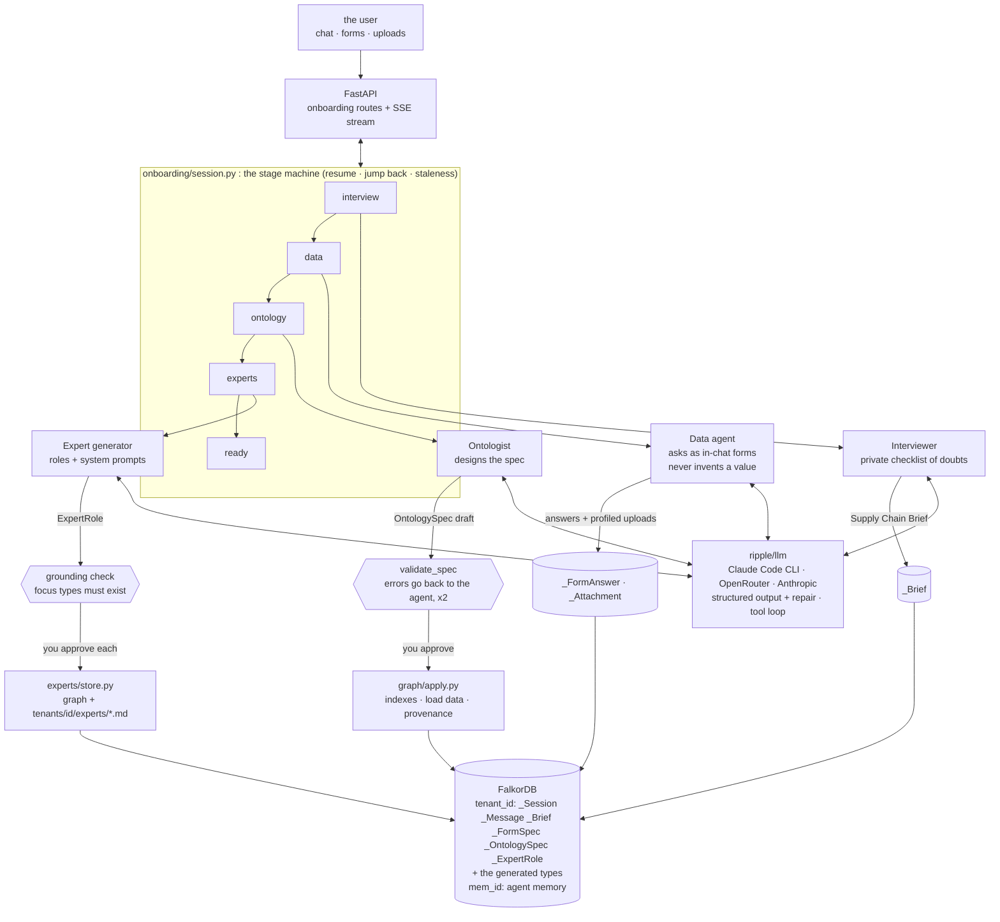
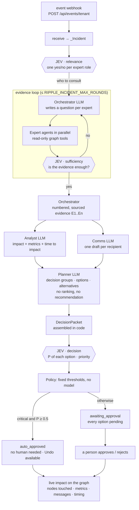
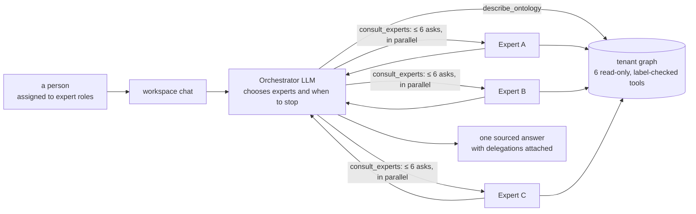

# Ripple: it interviews your company, builds its supply chain graph, then runs it

> **Graph Hacks: Context for AI Agents** (WeMakeDevs × FalkorDB), Oct 15–18, 2026.
> **Tracks entered: 01 (Agents That Act on Connected Data), 02 (Agent Memory and Coordination), 03 (Company Brain).**


Most graph demos ship with a schema. Ripple ships with none. A company arrives at an empty FalkorDB and Ripple
does two jobs, one after the other:

1. **Build.** Four agents talk to the business and turn *"we make shoes"* into a knowledge graph: they interview
   the company, ask for the data they need as forms in the chat, design an ontology and load the data against it,
   then **invent the expert agents that this particular supply chain needs**.
2. **Operate.** When something happens in the real world (a fire at a supplier, a port closing), those experts
   investigate it from the graph, a planner lays out the options, and **Jev, TypeSafe's decision model, makes the
   call**. People approve or reject; for a truly critical event nobody has time to, so policy lets Jev's choice
   stand.

Nothing is hard-wired. There is no DataCo, no shipped ontology, no fallback script. Every agent step is a real
LLM call, and **FalkorDB is the only hard dependency**: the onboarding state, the generated ontology, the
company's data, the expert roles, the incidents and every decision live in it.

```
 BUILD  (onboarding)                                                    OPERATE  (workflow)
 "we make shoes" ─► Interviewer ─► Data agent ─► Ontology agent ─► Expert generator ─► experts ─► event ─► evidence
                    a brief        a data pack    graph + data      agent roles                           ─► options ─► Jev ─► approve
```

## Contents

[The product](#the-product) · [Architecture 1: onboarding](#architecture-1-onboarding-the-agents-that-build-the-graph) ·
[Architecture 2: the workflow](#architecture-2-the-workflow-the-agents-that-operate-it) ·
[The ideas worth stealing](#the-ideas-worth-stealing) · [Run it](#run-it) · [Reference](#the-agents-prompts)

---

## The product

Screenshots are from the running app, on two tenants that Ripple onboarded itself: **Brightwater Brewing** (a craft
brewery) and **Amazon** (an e-marketplace fulfilment network). Nobody wrote their types, roles or prompts. Point
the same agents at a specialty coffee roaster and they ask about green coffee coverage by origin, bonded
warehousing and C-price volatility instead; nothing in this repository knows what coffee is.

### 1. Onboarding: a conversation, not a form


A stage rail (**Interview → Data → Ontology → Experts → Ready**) on top, the chat in the middle, and on the right
the **agent trail** (every LLM call, tool call and Jev decision, streamed live) and the **brief** as the
interviewer understands it. You can jump back to any stage you have reached; downstream artifacts are flagged
stale and re-derived. Everything persists in FalkorDB as it happens, so closing the browser mid-answer loses
nothing, including a turn that was in flight when the process died.

### 2. The ontology the agents designed


The schema as a graph (icon and colour per type, cardinality on every link), an inspector that explains the
selected type, and a *Read the model* view that turns every link into a sentence ("Each Supplier is based in one
Region; a Region can have many Suppliers."). Rename a type or ask the agent to merge two: it returns the whole
revised spec and the version history grows. Approving creates the indexes and loads the data pack.

### 3. Expert agents that did not exist an hour ago


Each role has a mandate, a justification grounded in the ontology (*"Stockouts on Prime items are a stated pain;
this role reasons over FulfillmentCenter, Product, Supplier…"*), the types it reasons over, and a full system
prompt that is stored in the graph **and** at `tenants/<id>/experts/<name>.md`, so you can review it in git, edit
it in a text editor and import it back. Ask any of them a question directly.

### 4. Overview and the instance graph


Headline numbers, objects by type, **hot spots read off the approved spec** (e.g. *"Parts linked to only one
Supplier: 38%"*, single-sourced and therefore fragile), open incidents and a quick-ask box for every expert.
Beside it, the **Object explorer** (every object, its links and the provenance of every value) and the
**Graph** page (the instance graph with type layers).


### 5. My workspace: a person, their roles and an agent team


Pick who you are; the persona scopes the view to your roles. Your dashboard shows the types
your roles reason over, your hot spots and the incidents that need you, next to a chat with the **agent team**:
an orchestrator that splits your question across the experts, runs them in parallel against the graph and returns
one sourced answer with the delegations attached.

### 6. Incidents: an event in, a decision out


A reported event, Jev's priority distribution (here *critical, 79%*, so no time for a human approval), and each
option as a card: reversibility, cost, risk, numbered steps, Jev's confidence and the evidence ids it rests on.
Green cards were auto-approved by policy and have an **Undo**; anything else waits for a person's Approve / Reject.

### What a judge sees (3 acts, ~4 minutes)

1. **Act 1: nothing up our sleeve (Track 01).** Start with an empty database: `/api/health` shows no graphs. Type a
   company name. The interviewer asks five questions, not fifty, and its private checklist appears in the agent
   trail. Upload a `suppliers.csv`: it is profiled (columns, dtypes, null rates, sample rows) and only the profile
   reaches the agent. The data agent then asks for exactly what is missing as a form; **Synthesize** fills the rest
   and badges every value `synthetic`, so the demo is honest about which numbers are real.
2. **Act 2: the model is yours (Track 01 + 03).** The ontologist drafts the spec; you edit it; you approve it.
   Click any node and **"where did this number come from?"** is answered from the graph, back to the exact form
   field or uploaded column.
3. **Act 3: agents that act (Tracks 01 + 02).** Approve the experts, report *"fire at the Pune fulfilment
   centre"*, and watch the incident pipeline run live: experts consulted, evidence gathered, options planned, Jev
   decides, impact shown on the graph.

Terminal version: `.venv/bin/python scripts/demo.py --company "Northwind Trainers"`. Replay a recorded run with no
LLM calls: `scripts/seed_from_run.py --db var/demo.db`; or load a hand-made footwear tenant with
`scripts/seed_mock.py` (marked `seeded_from="mock"`, objects `confidence="synthetic"`, events left undecided: only
Jev decides).

---

## Architecture 1: onboarding, the agents that build the graph

The build half is a **stage machine** that drives four LLM agents, one structured call per turn, and a host that
enforces the invariants the model must not be trusted with.



| # | Agent | Job | Produces | Approved by |
|---|---|---|---|---|
| 1 | **Interviewer** | A product manager who is also a supply chain expert. Keeps a private checklist of its own open doubts and works it down, so the interview's length scales with the business. | **Supply Chain Brief** | the agent, gated by a core-topic guard |
| 2 | **Data agent** | Decides what data would make the brief concrete and asks for it as **forms inside the chat**, round by round. Never invents a value. | **Data Pack**: answers, uploaded tables, documents | the agent |
| 3 | **Ontologist** | Designs the graph model from the brief and data pack, then loads the data with provenance. | **Ontology Spec** + a populated graph | **you** |
| 4 | **Expert generator** | Invents the roles this chain needs, justifies each against the ontology, writes its system prompt. | **Expert Roles** | **you**, role by role |

**What makes it robust**

* **The model converses, the host guards the invariants.** The interviewer sets `done: true`; the stage machine
  refuses while `Brief.core_gaps()` is non-empty and reopens a checklist item. An invalid spec or an ungrounded role
  goes back to the agent with the list of errors, up to twice, before the user sees it.
* **The ontology is data, not code.** Cypher cannot parameterise a label, so every generated label passes
  `validate_spec` and then exactly one guarded interpolation point (`graph/queries.ident`). Query text still lives
  in `graph/queries/*.cypher` as `kind: template`.
* **Provenance is an edge.** Every generated node has `HAS_PROVENANCE → _Provenance → FROM_SOURCE → _FormAnswer |
  _Attachment`, so *"where did this come from?"* is one Cypher query.
* **Everything resumes.** State is written to FalkorDB as it happens; a crashed turn is replayed from `pending_json`.

---

## Architecture 2: the workflow, the agents that operate it

Once the experts exist, the same graph runs the day-to-day. There are two entry points, and they deliberately
treat *choice* differently.

### 2a. The incident pipeline (an event arrives)

`POST /api/events/{tenant}` accepts any JSON with a free-text `summary` (a webhook, or the Report box in the UI).
The pipeline turns it into a decision. **LLM agents generate; only Jev decides.**



Every agent reply passes a deterministic validator (`ripple/incident/validate.py`): experts that exist, node ids
that actually came back from tools, evidence ids that are in the report, an exclusive group with exactly one
*wait* option. A rejected reply goes back to the model with the problems listed, twice. A run that still fails is
recorded on the incident with its error; it is never lost.

**Who decides what**

| A decision that would be easy to hide in a prompt | Is instead |
|---|---|
| which experts to ask | a Jev yes/no per approved role |
| when to stop questioning | a Jev yes/no after each round, plus a round cap |
| which option to take, and how urgent it is | one Jev `choice` per exclusive group, one yes/no per independent action, one 4-level `score` for priority |
| whether a human must look | policy thresholds on Jev's probabilities (`ripple/decide/policy.py`), not a model |

The LLM agents never see a probability or a verdict (`tests/test_incident.py` checks this). **Jev** is
[TypeSafe's decision model](reference/JEV_VERIFIED.md), not an LLM: it takes a state and typed questions and
returns calibrated probabilities. It lives in `ripple/decide/`, never in `ripple/llm/`. Its state includes the two
or three nearest of nine documented real disruptions (Philips/Nokia/Ericsson 2000, Aisin 1997, Ever Given, Red
Sea, Baltimore bridge…) as precedents. Full spec: [`docs/m8_decision_pipeline.md`](docs/m8_decision_pipeline.md).

**Autonomy is policy.** Priority measures how long a decision can wait for a person, not how high the stakes are.
Only a `critical` event (options disappearing within hours) with P(critical) ≥ 0.5 is auto-approved; an
independent action also needs P(yes) ≥ 0.6. Everything else is queued with Jev's probability beside each option.
"Execute" means the option is marked approved and its live impact is shown on the graph: the nodes it touches, the metrics it moves, the messages it sends and when it takes effect.

### 2b. The workspace chat (a person asks a question)



Here an LLM routes, by the owner's choice: it only **answers questions** and never approves or acts. That is the
one sanctioned exception to *only Jev decides*, and it is not extended to anything that decides or acts.

### The expert runtime both paths share

One generic agent runs any role: its system prompt comes from the graph, its tools are the six below, and none
knows a label in advance (`describe_ontology` tells it). Every tool takes a type from the tenant's *approved* spec
and rejects anything else. Answers cite node ids that an **id validator** checked against what the tools actually
returned. That is how a role that was invented ten minutes ago can safely answer from a graph it has never seen.

### Side by side

| | Onboarding (build) | Workflow (operate) |
|---|---|---|
| Trigger | a person starts a company | an event webhook, or a question in the workspace chat |
| Shape | linear stages, but you can jump back | evidence loop → report → options → decision |
| LLM's job | converse, design, write prompts | gather evidence, draft messages, enumerate options |
| Who chooses | the user approves each artifact | **Jev** (incidents); the orchestrator only routes answers (chat) |
| Guardrails | `validate_spec`, core-gap guard, grounding check | referential validator, policy thresholds, Undo |
| Writes | `_Brief`, `_OntologySpec`, instance nodes, `_ExpertRole` | `_Incident`, `_Option`, `_JevDecision`, `_Approval` |
| Streams to | `/api/onboarding/stream` | the same stream, with `stage: "incident"` or `"workspace"` |

---

## The ideas worth stealing

* **The agent's checklist is its working memory.** The interviewer and data agent emit `add`/`resolve`/`revise`/
  `drop` operations on a private checklist persisted as `_ChecklistItem` nodes. It stops repetition and ends the
  interview when the business is understood rather than after N questions.
* **Never invent data.** The data agent asks for a ballpark rather than fill a number in, and every answer carries
  `source` and `confidence`, carried onto the loaded nodes, so an expert can say *"this rests on a ballpark"*.
* **Separate generation from choice.** Making evidence, drafts and options is what LLMs are good at; picking is a
  calibrated-probability problem. Splitting them makes the choice auditable and the autonomy tunable.
* **Validation is a conversation, not an exception.** Errors go back to the agent with the list of problems.
* **No fakes.** There is no scripted mode and no `FakeLLM`: the suite is {{N_TESTS}} deterministic tests (no
  network) plus a live half under `-m llm`. Tests reach Jev only through the real client over a mock HTTP transport.

## Run it

```bash
bash scripts/setup_env.sh                  # offline from vendor/
.venv/bin/uvicorn ripple.api.app:app       # the API owns the embedded FalkorDB
cd ui && npm run dev                       # http://localhost:5173
```

The default LLM provider is **Claude Code on your own login**, no API key: Ripple shells out to `claude -p` with its
own tools off. Set `RIPPLE_LLM_PROVIDER=openrouter` + `OPENROUTER_API_KEY`, or `anthropic` + `ANTHROPIC_API_KEY`
to use an API instead (see `.env.example`). Jev needs `OPENROUTER_API_KEY` (or `JEV_BASE_URL` + `JEV_API_KEY`).

```bash
.venv/bin/pytest -q                        # {{N_TESTS}} deterministic tests, no network
.venv/bin/pytest -q -m llm                 # the live half: real agent calls
.venv/bin/pytest -q -m jev                 # the real Jev decision model
cd ui && npm run build                     # typecheck + bundle
docker compose up                          # FalkorDB + API + UI in one stack
RIPPLE_DB_MODE=remote .venv/bin/pytest -q  # against docker run -p 6379:6379 falkordb/falkordb:v4.18.3
```

## The agents' prompts

The prompts are the product. They are versioned in git, read at call time, and nothing in the code paraphrases
them.

{{PROMPTS}}

## The artifact models

These pydantic models are the contract in three directions at once: the JSON schema sent to the model, the
validation of what comes back, and the shape the UI reads.

{{MODELS}}

## The expert runtime's tools ({{N_TOOLS}})

None of them knows a label in advance. Every one takes a type from the tenant's *approved* spec and is rejected
if it names anything else, which is how one tool set works for every generated ontology.

{{TOOLS}}

## The graph

### Platform labels (`_`-prefixed, so a generated label can never collide)

| Label | What it holds |
|---|---|
| `_Tenant` | the company: `id`, `name`, `stage`, `status`, `has_synthetic` |
| `_Session` | the onboarding cursor: `stage`, `provider`, `model`, `pending_json` (the turn in flight) |
| `_Message` | every chat turn, with `kind` = `text` / `form` / `attachment` / `system` / `artifact` |
| `_ChecklistItem` | an agent's private open doubts, per stage |
| `_Attachment` | an upload: `sha256`, `kind`, `profile_json`, `summary` |
| `_Brief` | the Supply Chain Brief, versioned, never overwritten |
| `_FormSpec` / `_FormAnswer` | a form round and its per-field answers, with `source` and `confidence` |
| `_OntologySpec` / `_OntologyType` | the generated model, versioned, with `status` `draft`/`approved`/`superseded` |
| `_ExpertRole` | a role: mandate, justification, focus, playbook and its full system prompt |
| `_AgentStep` / `_ToolCall` | the audit and stream trail |
| `_Provenance` | the bridge from a loaded node back to the answer or upload it came from |

Edges: `(_Session)-[:HAS_MESSAGE]->(_Message)`, `(_FormSpec)-[:HAS_ANSWER]->(_FormAnswer)`,
`(_Brief|_OntologySpec)-[:DERIVED_FROM]->(_Message|_FormAnswer|_Attachment)`,
`(_OntologySpec)-[:DEFINES]->(_OntologyType)`, `(_ExpertRole)-[:FOCUSES_ON]->(_OntologyType)`,
`(node)-[:HAS_PROVENANCE]->(_Provenance)-[:FROM_SOURCE]->(_FormAnswer|_Attachment)`.

### Every query ({{N_QUERIES}} files)

Every query Ripple runs lives in `graph/queries/*.cypher` with a header the docs are generated from. The ones
marked `template` carry `{placeholders}` filled from the approved spec — that is how a per-tenant ontology is
queried without string-building Cypher in Python.

{{QUERIES}}

## Measured numbers

{{NUMBERS}}

## FalkorDB notes

`reference/FALKORDB_VERIFIED.md` records what was verified by running it (embedded `falkordblite` 0.10.0, graph
module v4.18.3). The ones this build turns on:

* **Map-valued properties are rejected.** Instance properties are flattened one level and anything deeper is
  JSON-encoded (`graph/apply.py:_flat`).
* **`MERGE` on an unlabelled pattern scans the graph.** Loading edges grouped by `(relationship, from label, to
  label)` so both `MATCH`es hit an id index made the instance load **~50× faster** (16.3 s → 0.33 s for 11.5k
  entities).
* **Re-running `CREATE INDEX` raises.** Both the platform schema and `apply_spec` treat "already exists" as
  success, so approving an ontology twice is safe.
* **One process owns an embedded `.db` file.** The API process owns it; everything else goes through the HTTP
  API or runs in-process.


## Team

Team Iota: Divyansh Parashar (developer), Virag Tiwari (co-founder, Orange Cat Technologies) and Vaibhav, all
final-year undergraduates.

## Licence and provenance

MIT, see [LICENCE](LICENSE). AI-assisted build: [`AI_DISCLOSURE.md`](AI_DISCLOSURE.md). The build plan and its
milestones: [`plan.md`](plan.md); the original pitch: [`idea.md`](idea.md); v1's plan, for the record:
[`docs/plan_v1_dataco.md`](docs/plan_v1_dataco.md).
