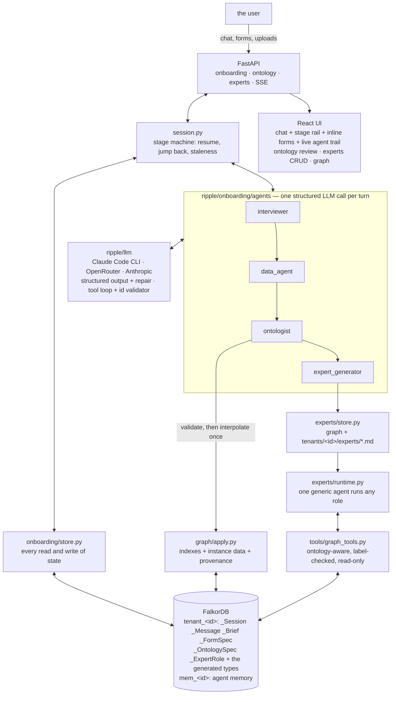

# Ripple: it interviews your company and builds the graph

> **Graph Hacks: Context for AI Agents** (WeMakeDevs × FalkorDB), Oct 15–18, 2026.
> **Tracks entered: 01 (Agents That Act on Connected Data), 02 (Agent Memory and Coordination), 03 (Company Brain).**

Most graph demos ship with a schema. Ripple ships with none. A company arrives at an empty FalkorDB, and four
agents turn *"we make shoes"* into a running knowledge-graph application: they interview the business, work out
what data is needed and ask for it as forms in the chat, design the ontology and load the company's data against
it, and then **invent the expert agents that this particular supply chain needs** — writing each one's system
prompt, justifying it against the ontology it reasons over, and running it as a real agent over the graph.

Nothing is hard-wired. There is no DataCo, no shipped ontology, no fallback script. Every agent step is a real
LLM call, and **FalkorDB is the only hard dependency**: the onboarding state, the generated ontology, the
company's instance data, the expert roles and all agent memory live in it.

```
"we make shoes"  ─►  Interviewer  ─►  Data agent  ─►  Ontology agent  ─►  Expert generator  ─►  a live app
                     a brief          a data pack     a graph + data      agents that answer
```

Everything below is one real run — a mid-sized shoe manufacturer, interviewed end to end
(`artifacts/llm_runs/`, replayed into a clickable tenant by `scripts/seed_from_run.py`). Nobody wrote these
types, these roles or these prompts.


| | |
|---|---|
|  |  |

## The four agents

| # | Agent | Role | Produces | Approved by |
|---|---|---|---|---|
| 1 | **Interviewer** | A product manager who is also a supply chain expert. Keeps a private checklist of its own open doubts and works it down, so the interview's length scales with how complicated the business is. | A structured **Supply Chain Brief** | the agent, gated by a core-topic guard |
| 2 | **Data agent** | Decides what data would make the brief concrete and asks for it as **forms inside the chat** — iterative, narrowing, round by round. Never invents a value. | A **Data Pack**: answers, uploaded tables, documents | the agent |
| 3 | **Ontology agent** | Designs the tenant's graph model from the brief and the data pack, then loads the data against it with provenance. | An **Ontology Spec** + a populated graph | **you**, in the UI |
| 4 | **Expert generator** | Invents the expert roles this supply chain needs, justifies each against the ontology, and writes its full system prompt. | **Expert Roles**, each a real runtime agent | **you**, role by role |

Onboarding is **non-linear**: you can jump back to any stage you have reached, and every downstream artifact is
flagged stale and re-derived. Everything persists in FalkorDB as it happens, so closing the browser mid-answer
loses nothing — including a turn that was in flight when the process died.

## What a judge sees (3 acts, ~4 minutes)

1. **Act 1 — nothing up our sleeve (Track 01).** Start with an empty database: `/api/health` shows no graphs.
   Type a company name. The interviewer asks five questions, not fifty, and its private checklist appears in the
   live agent trail on the right. Answer three turns, upload a `suppliers.csv`, and watch the brief fill in on
   the right-hand panel — the upload is profiled (columns, dtypes, null rates, five sample rows) and only the
   profile reaches the agent's context. The data agent then asks for exactly what is missing as a form with a
   repeating supplier table; press **Synthesize** and every value comes back badged `synthetic`, because a demo
   should not need your real numbers to be honest about which ones they are.
2. **Act 2 — the model is yours (Track 01 + 03).** The ontology agent drafts the spec and the diagram renders
   from it: your types, your words, with lead time on the `SUPPLIES` edge where it belongs. Rename a type in the
   table or ask the agent in chat to merge two — it returns the whole revised spec and the version history grows.
   Approve: indexes are created, the data pack is read into the approved types, and clicking any node answers
   **"where did this number come from?"** from the graph — back to the exact form field or uploaded column.
3. **Act 3 — agents that did not exist an hour ago (Tracks 01 + 02).** The expert generator proposes the roles
   *this* chain needs, each with an ontology-grounded justification; a role whose focus types are not in the spec
   is rejected and the agent is told to drop or merge it. Approve them, then ask one a question. It calls
   `describe_ontology` (it does not know your labels in advance either), walks the graph, and answers citing node
   ids that an **id validator** has checked against what the tools actually returned. Its prompt is in the graph
   *and* at `tenants/<id>/experts/<name>.md`, so you can review it in git, edit it in a text editor, and import
   it back.


Terminal walk-through of the same three acts: `.venv/bin/python scripts/demo.py --company "Northwind Trainers"`.
Or replay a recorded run into a database you can click through, with no LLM calls at all:

```bash
.venv/bin/python scripts/seed_from_run.py --db var/demo.db
RIPPLE_DB_PATH=var/demo.db .venv/bin/uvicorn ripple.api.app:app
```

## Architecture



### The ideas worth stealing

* **The ontology is data, not code.** A per-tenant model means Cypher cannot parameterise a label, so every
  generated label passes `validate_spec` and then exactly one guarded interpolation point
  (`graph/queries.ident`, regex `^[A-Za-z][A-Za-z0-9_]{0,63}$`). The query *text* still lives in
  `graph/queries/*.cypher` as `kind: template`, so the house rule survives a dynamic schema.
* **The agent's checklist is its working memory.** The interviewer and the data agent emit
  `add`/`resolve`/`revise`/`drop` operations on a private checklist, persisted as `_ChecklistItem` nodes. It
  stops repetition, it makes the interview end when the business is understood rather than after N questions,
  and `open` count is the progress signal the stage machine reads.
* **An agent decides it is finished; the host decides whether it may be.** The interviewer sets `done: true`;
  the stage machine refuses while `Brief.core_gaps()` is non-empty and reopens a checklist item instead. The
  model is in charge of the conversation, the code is in charge of the invariant.
* **Validation is a conversation, not an exception.** An invalid spec or an ungrounded expert role goes back to
  the agent with the list of errors, up to twice, before the user ever sees it.
* **Never invent data.** The data agent must ask for a ballpark rather than fill a number in, and every answer
  carries `source` and `confidence` — which are carried onto the loaded nodes, so an expert can say *"this rests
  on a ballpark"*. `Synthesize` is a separate, explicitly demo-only pass that flags the whole tenant.
* **Provenance is an edge, not a log line.** Every generated node has `HAS_PROVENANCE → _Provenance → FROM_SOURCE
  → _FormAnswer | _Attachment`, so *"where did this come from?"* is one Cypher query.
* **No fakes.** There is no scripted mode and no `FakeLLM` to hide behind: the suite is split into
  {{N_TESTS}} deterministic tests (no network) and a live half under `-m llm` whose transcripts are recorded.

## Run it

```bash
bash scripts/setup_env.sh                  # offline from vendor/
.venv/bin/uvicorn ripple.api.app:app       # the API owns the embedded FalkorDB
cd ui && npm run dev                       # http://localhost:5173
```

The default LLM provider is **Claude Code on your own login** — no API key: Ripple shells out to `claude -p`
with its own tools off. Set `RIPPLE_LLM_PROVIDER=openrouter` + `OPENROUTER_API_KEY`, or `anthropic` +
`ANTHROPIC_API_KEY`, to use an API instead. See `.env.example`.

```bash
.venv/bin/pytest -q                        # {{N_TESTS}} deterministic tests, no network
.venv/bin/pytest -q -m llm                 # the live half: real agent calls, recorded
cd ui && npm run build                     # typecheck + bundle
docker compose up                          # FalkorDB + API + UI in one stack
```

## The agents' prompts

The prompts are the product. They are versioned in git, read at call time, and nothing in the code paraphrases
them.

{{PROMPTS}}

## The artifact models

These pydantic models are the contract in three directions at once: the JSON schema sent to the model, the
validation of what comes back, and the shape the UI reads.

{{MODELS}}

## The expert runtime's tools ({{N_TOOLS}})

None of them knows a label in advance. Every one takes a type from the tenant's *approved* spec and is rejected
if it names anything else, which is how one tool set works for every generated ontology.

{{TOOLS}}

## The graph

### Platform labels (`_`-prefixed, so a generated label can never collide)

| Label | What it holds |
|---|---|
| `_Tenant` | the company: `id`, `name`, `stage`, `status`, `has_synthetic` |
| `_Session` | the onboarding cursor: `stage`, `provider`, `model`, `pending_json` (the turn in flight) |
| `_Message` | every chat turn, with `kind` = `text` / `form` / `attachment` / `system` / `artifact` |
| `_ChecklistItem` | an agent's private open doubts, per stage |
| `_Attachment` | an upload: `sha256`, `kind`, `profile_json`, `summary` |
| `_Brief` | the Supply Chain Brief, versioned, never overwritten |
| `_FormSpec` / `_FormAnswer` | a form round and its per-field answers, with `source` and `confidence` |
| `_OntologySpec` / `_OntologyType` | the generated model, versioned, with `status` `draft`/`approved`/`superseded` |
| `_ExpertRole` | a role: mandate, justification, focus, playbook and its full system prompt |
| `_AgentStep` / `_ToolCall` | the audit and stream trail |
| `_Provenance` | the bridge from a loaded node back to the answer or upload it came from |

Edges: `(_Session)-[:HAS_MESSAGE]->(_Message)`, `(_FormSpec)-[:HAS_ANSWER]->(_FormAnswer)`,
`(_Brief|_OntologySpec)-[:DERIVED_FROM]->(_Message|_FormAnswer|_Attachment)`,
`(_OntologySpec)-[:DEFINES]->(_OntologyType)`, `(_ExpertRole)-[:FOCUSES_ON]->(_OntologyType)`,
`(node)-[:HAS_PROVENANCE]->(_Provenance)-[:FROM_SOURCE]->(_FormAnswer|_Attachment)`.

### Every query ({{N_QUERIES}} files)

Every query Ripple runs lives in `graph/queries/*.cypher` with a header the docs are generated from. The ones
marked `template` carry `{placeholders}` filled from the approved spec — that is how a per-tenant ontology is
queried without string-building Cypher in Python.

{{QUERIES}}

## Measured numbers

{{NUMBERS}}

## FalkorDB notes

`reference/FALKORDB_VERIFIED.md` records what was verified by running it (embedded `falkordblite` 0.10.0, graph
module v4.18.3). The ones this build turns on:

* **Map-valued properties are rejected.** Instance properties are flattened one level and anything deeper is
  JSON-encoded (`graph/apply.py:_flat`).
* **`MERGE` on an unlabelled pattern scans the graph.** Loading edges grouped by `(relationship, from label, to
  label)` so both `MATCH`es hit an id index made the instance load **~50× faster** (16.3 s → 0.33 s for 11.5k
  entities).
* **Re-running `CREATE INDEX` raises.** Both the platform schema and `apply_spec` treat "already exists" as
  success, so approving an ontology twice is safe.
* **One process owns an embedded `.db` file.** The API process owns it; everything else goes through the HTTP
  API or runs in-process.

Known limits and workarounds: [`docs/KNOWN_ISSUES.md`](docs/KNOWN_ISSUES.md).

## What is deliberately not here yet

The post-onboarding application. v1 built a control tower (incidents, blast radius, actions, playbooks,
company brain) on a fixed ontology; all of that is archived rather than reused, because on a *generated*
ontology the shape of an incident, an action and a playbook is a design question, not a port. `plan.md` §10 is
where it picks up; the expert runtime's read-only tool set is the deliberate minimum that proves a generated
role is alive.

## Licence and provenance

MIT, see [LICENCE](LICENSE). AI-assisted build: [`AI_DISCLOSURE.md`](AI_DISCLOSURE.md). The build plan and its
milestones: [`plan.md`](plan.md); the original pitch: [`idea.md`](idea.md); v1's plan, for the record:
[`docs/plan_v1_dataco.md`](docs/plan_v1_dataco.md).
