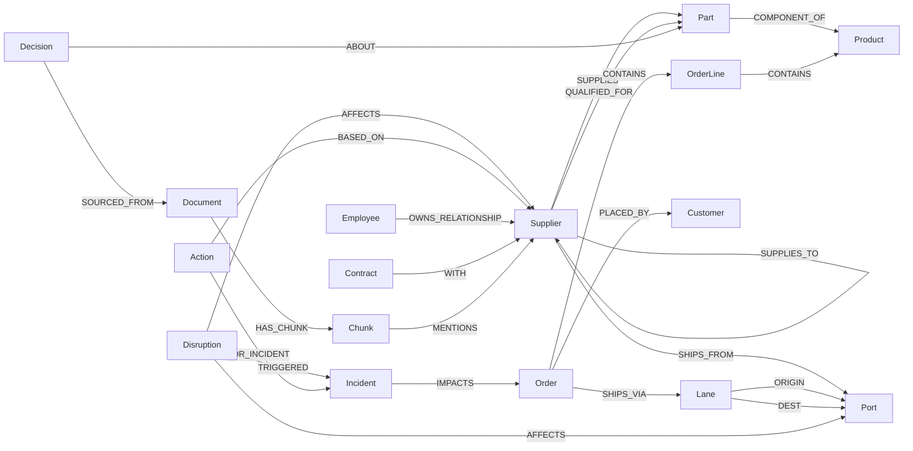
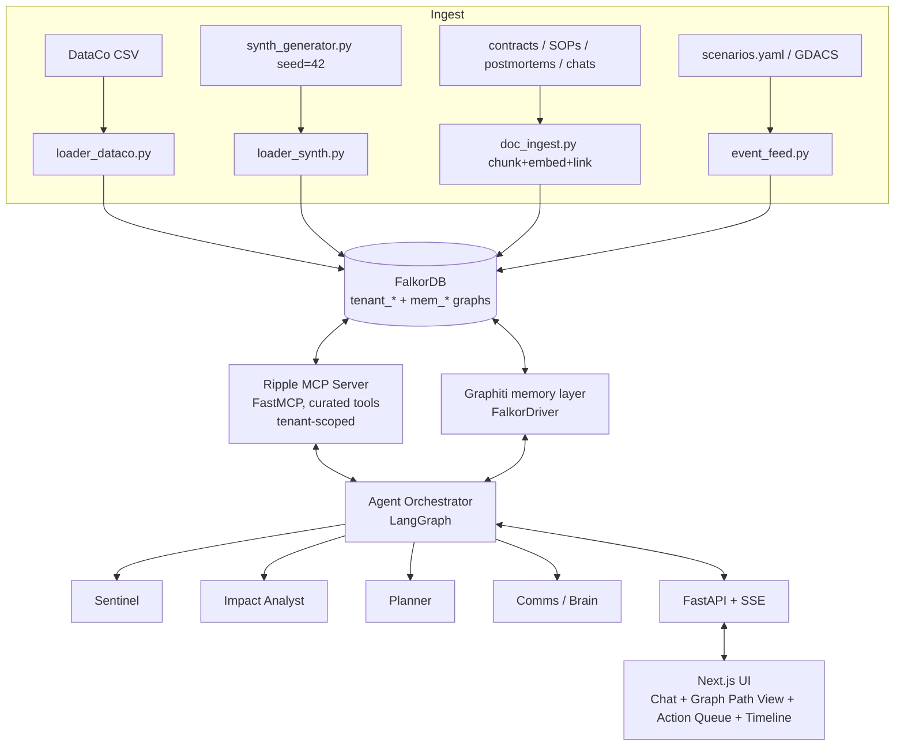

# Ripple: A Graph-Native Supply Chain Control Tower

> **Graph Hacks: Context for AI Agents** (WeMakeDevs x FalkorDB), Oct 15 to 18, 2026
> **Entering:** Track 01 (Agents That Act on Connected Data), Track 02 (Agent Memory and Coordination), Track 03 (Company Brain)
> **Primary database:** FalkorDB

---

## 0. TL;DR

A disruption hits the supply chain: a port closes, a supplier's plant burns, or a carrier strikes. **Ripple** is a team of AI agents that sit on a Palantir-style **ontology** stored in FalkorDB. The agents:

1. **Trace the blast radius.** They walk from the disruption through ports, lanes, suppliers, parts, products and orders to the customers affected, and put a revenue figure on it.
2. **Decide and act.** They find alternate suppliers or lanes with graph algorithms, then propose and execute mitigations. Each mitigation is written back to the graph as an auditable `Action`.
3. **Remember.** They recall past disruptions, what was tried, and what worked, across sessions, and they share state between agents and keep each tenant's data isolated.
4. **Know the company.** They know who owns each supplier relationship, which contract clause applies, and why a past sourcing decision was made, and every answer cites its sources.

Every answer comes with **the exact path through the graph** that produced it.

---

## 1. Hackathon Facts and Constraints

| Item | Detail |
|---|---|
| Window | Oct 15, 12:01 AM IST to **Oct 18, 11:59 PM IST** |
| Team | Solo or up to 4. **Each person can be on only one team.** |
| Tracks | One submission can enter all three. **Name every track when submitting.** |
| Required tech | FalkorDB as the primary graph DB, supporting a central part of the product |
| "Graph must do real work" | If the product still works with FalkorDB removed, it is disqualified as decoration |
| Data | Public, synthetic, or your own. **No personal, login-protected, paywalled or restricted data.** |
| Original work | Main coding and design work starts after kickoff. Public libraries, templates and datasets are allowed. |
| AI assistants | Allowed, **must be disclosed**. The team must be able to explain the model, queries, architecture and decisions. |
| Deployment | Live deployment preferred, otherwise full local setup instructions plus a working demo video |

**Prizes:**
* Track 01: iPhone 18 Pro
* Track 02: PS5 with GTA VI
* Track 03: M6 Mac Mini
* Side prize: AirPods 5 for the best blog post
* Top 50 teams: t-shirts

**Mandatory submission contents:**
- [ ] Public source-code repository
- [ ] README with setup instructions **and the graph data model**
- [ ] The Cypher queries and graph algorithms the product depends on
- [ ] Demo video showing the working project
- [ ] Live deployment, or complete local setup instructions
- [ ] Tracks entered (all three)
- [ ] AI-assistant usage disclosure

---

## 2. Problem, Idea, Goal

### 2.1 Problem
Supply chain questions are **connection questions**:
- "If the Port of Shanghai closes for 10 days, which customer orders are late, and how much revenue is at risk?"
- "Which single supplier, if it fails, hurts us the most?"
- "Who owns our relationship with that supplier, and what does the contract say about delays?"
- "Did this happen before? What did we do, and did it work?"

In relational systems, each of these takes 5 to 8 joins across ERP, TMS, contracts and chat tools, stitched together by a human analyst over days. LLM agents with plain vector RAG see fragments, forget past incidents, and cannot show why they recommended something.

### 2.2 Idea
Model the company as an **ontology** in FalkorDB, following Palantir's design:

| Palantir concept | Ripple implementation |
|---|---|
| **Object types** | Node labels: `Supplier`, `Part`, `Product`, `Order`, `Port`, `Employee`, ... |
| **Properties** | Node properties, such as lead time, capacity, revenue and risk score |
| **Link types** | Typed relationships: `SUPPLIES`, `COMPONENT_OF`, `SHIPS_VIA`, `OWNS_RELATIONSHIP`, ... |
| **Functions** | MCP tools wrapping curated Cypher and graph algorithms |
| **Action types** | Write tools that create `(:Action)` nodes linked to evidence, agent and approver, with state transitions |
| **Interfaces** | Shared shapes such as `:Node:RiskBearing` on Supplier, Port and Lane |
| **Ontology-augmented generation** | Agents answer only from graph context and vector-indexed chunks attached to graph entities |

### 2.3 Goal
Ship a deployed, demo-ready control tower in which:
1. A judge can **trigger a disruption** and watch four agents trace, decide, act and report in under 60 seconds, with the path highlighted.
2. After a **restart**, the agents **recall** the earlier incident and reuse the playbook that worked.
3. A judge can ask **"who owns / why did we / what does the contract say"** and get an answer with clickable sources.

### 2.4 Success criteria (our internal judging rubric)

| Criterion | Target |
|---|---|
| Graph does real work | 100% of agent answers come from Cypher or algorithm calls, with a "no FalkorDB means no product" argument in the README |
| Multi-hop | Blast radius spans 5 or more hops (Disruption → Port → Lane → Order ← Product ← Part ← Supplier, plus Customer) |
| Explainability | Every answer shows its path and every action shows its evidence nodes |
| Memory | Cross-session recall demonstrated live, with 3 memory types visible in the graph |
| Coordination | 4 agents with explicit handoffs and shared state, plus 2 tenants isolated |
| Company brain | 5 or more question types answered with sources |
| Correctness | Injected scenarios have known ground truth, and the agents match it (Section 15) |
| Polish | Live URL, 3 to 4 minute video, README with model and queries, blog post |

---

## 3. Track Coverage Matrix

| Track key focus | Where Ripple shows it |
|---|---|
| **T1** Multi-hop reasoning | Blast radius traversal; alternate-supplier search across BOM and qualification links |
| **T1** Graph queries and algorithms as tools | `blast_radius`, `single_points_of_failure` (betweenness), `supplier_influence` (PageRank), `supplier_clusters` (community detection), `alt_route` (shortest path) |
| **T1** Tool selection through MCP | Ripple MCP server; agents pick tools dynamically and the tool trace is shown in the UI |
| **T1** Actions based on what the graph shows | `propose_action` / `execute_action`: reroute, expedite, split order, switch supplier, notify owner |
| **T1** Explainable results | Path highlight plus `Action -[:BASED_ON]->` evidence |
| **T2** Episodic, semantic, procedural memory | `Episode`, `Fact` (temporal), `Playbook` nodes in a memory graph |
| **T2** Persistent conversation history | `Conversation` / `Message` nodes per user |
| **T2** Shared state and handoffs | `Incident` node as a shared blackboard with `HANDED_OFF_TO` edges between agent steps |
| **T2** High-concurrency reads and writes | Parallel agents writing to one incident; load script with N concurrent sessions |
| **T2** Separate memory per user or tenant | FalkorDB multigraph: `tenant_dataco`, `tenant_nova`, `mem_dataco`, `mem_nova` |
| **T3** Knowledge from docs, tickets, chats | Contracts, SOPs, postmortems and chat threads → `Document` / `Chunk` linked to entities |
| **T3** Who owns what, who knows what | `OWNS_RELATIONSHIP`, `AUTHORED`, `PARTICIPATED_IN`, plus expertise ranking |
| **T3** Tracing decisions to source | `Decision -[:SOURCED_FROM]-> Document/Message` |
| **T3** Keeping knowledge current | Incremental ingest; temporal `valid_from` / `valid_to` on facts and ownership |
| **T3** Answers with clear sources | Every answer lists node IDs plus document and chunk citations |

---

## 4. Datasets

### 4.1 Primary: DataCo Smart Supply Chain (real, public)

| Field | Detail |
|---|---|
| Source (Kaggle) | https://www.kaggle.com/datasets/shashwatwork/dataco-smart-supply-chain-for-big-data-analysis |
| Original record (Mendeley, DOI 10.17632/8gx2fvg2k6) | https://data.mendeley.com/datasets/8gx2fvg2k6/1 |
| Authors | Fabian Constante, Fernando Silva, António Pereira (cite in README) |
| Size | 180,519 order-item rows, 53 columns, covering 2015 to 2019 |
| Files | `DataCoSupplyChainDataset.csv` (structured), `DescriptionDataCoSupplyChain.csv` (data dictionary), `tokenized_access_logs.csv` (clickstream, optional) |
| Product types | Clothing, sports, electronic supplies |
| Labels | `Late_delivery_risk` (0/1) and `Delivery Status`; these give us ground truth |

**Columns used:**

| Area | Columns |
|---|---|
| Order | `Order Id`, `Order Item Id`, `order date (DateOrders)`, `Order Status`, `Order Region`, `Order Country`, `Order City`, `Market` |
| Line item | `Order Item Quantity`, `Order Item Total`, `Order Profit Per Order`, `Sales` |
| Product | `Product Card Id`, `Product Name`, `Product Price`, `Category Id/Name`, `Department Id/Name` |
| Shipping | `Shipping Mode`, `shipping date (DateOrders)`, `Days for shipping (real)`, `Days for shipment (scheduled)`, `Delivery Status`, `Late_delivery_risk` |
| Customer | `Customer Id`, `Customer Segment`, `Customer City/State/Country` |

**PII handling (rule compliance):** drop the customer first name, last name, email, password and street columns at load time. Keep only the ID, segment and city-level location. Document this in the README.

### 4.2 Synthetic layers we generate (seeded, reproducible, labeled synthetic)

DataCo has no supplier tiers, BOM, ports or org chart. We generate them deterministically from `seed=42`, so the graph is rich and every injected scenario has a known answer.

| Layer | Volume (target) | How it is generated |
|---|---|---|
| Suppliers (tier 1/2/3) | ~150 / 300 / 200 | Faker company names with a `[SYNTH]` tag, countries weighted by real manufacturing share, capacity, reliability score |
| Parts | ~600 | Per DataCo category: 3 to 8 parts per product (fabric, zipper, PCB, battery ...) |
| BOM edges | ~2,000 | `(Part)-[:COMPONENT_OF {qty}]->(Product)` |
| Supply edges | ~3,000 | `(Supplier)-[:SUPPLIES {lead_time_days, unit_cost, share}]->(Part)`, with 20% of parts single-sourced on purpose |
| Tier edges | ~800 | `(Supplier)-[:SUPPLIES_TO]->(Supplier)` |
| Qualified alternates | ~400 | `(Supplier)-[:QUALIFIED_FOR]->(Part)` that are not active today |
| Ports | ~25 | Real public port names and coordinates (Shanghai, Singapore, Rotterdam, LA/Long Beach, Santos, Mumbai/JNPT ...) |
| Lanes | ~120 | `(Lane {mode, transit_days})` connecting origin port → destination port, mapped to DataCo `Shipping Mode` and `Market` |
| Plants and warehouses | ~12 / ~20 | One or more per DataCo market |
| Employees and teams | ~40 / 6 | Synthetic names. Teams: Procurement, Logistics, Planning, Quality, Legal, Customer Ops |
| Contracts | ~60 | Generated markdown with clauses: lead time SLA, delay penalty, force majeure, exclusivity |
| SOPs and playbooks | ~15 | Port closure, supplier insolvency, quality hold, expedite approval matrix |
| Postmortems | 4 | Past incidents with decisions and outcomes, for example "2024 Shenzhen typhoon" |
| Chat threads | ~30 | Slack-style JSON threads around incidents and sourcing decisions, which contain the "why" |
| Second tenant "Nova Retail" | ~10% scale | Same generator, different seed and products, used to prove tenant isolation |

All synthetic text is LLM-generated from templates and checked into `data/synthetic/`, so judges can inspect it.

### 4.3 Disruption events

| Source | Use |
|---|---|
| **Scripted scenarios** (primary) | `scenarios/*.yaml` with known ground truth: port closure, tier-2 fire, carrier strike, quality hold |
| **GDACS** (Global Disaster Alert and Coordination System, public) https://www.gdacs.org | Optional stretch: poll real alerts (cyclones, floods, earthquakes), geo-match them to ports and suppliers, and raise a `Disruption` |

### 4.4 Optional and stretch datasets

| Dataset | Link | Why |
|---|---|---|
| Olist Brazilian E-Commerce (anonymised, 9 linked tables) | https://www.kaggle.com/datasets/olistbr/brazilian-ecommerce | Real second tenant with sellers and geolocation, which makes the tenant-isolation demo use genuinely different data |
| SupplyGraph (FMCG supply chain as a graph) | https://github.com/CIOL-SUST/SupplyGraph | Real plant, product and storage graph; optional realism for the plant layer |

### 4.5 Evaluation data for memory (Track 2)
Our domain-specific test is a scripted multi-session scenario (Section 15). If time permits, we also report a small run on a public memory benchmark:
- **LongMemEval**: https://github.com/xiaowu0162/LongMemEval
- **LoCoMo**: https://snap-research.github.io/locomo

---

## 5. Graph Data Model (Ontology)

### 5.1 Graph layout (FalkorDB multigraph)

| Graph key | Contents |
|---|---|
| `tenant_dataco` | Operational ontology plus company-brain docs for DataCo |
| `tenant_nova` | Same schema, second tenant |
| `mem_dataco` | Agent memory for DataCo: episodes, facts, playbooks, conversations |
| `mem_nova` | Agent memory for Nova |

Agents receive a `tenant_id` and can only open that tenant's two graphs. Isolation is enforced in the MCP server, not in the prompt.

### 5.2 Node labels (object types)

| Label | Key properties |
|---|---|
| `Supplier` | `id, name, tier, country, lat, lon, capacity, reliability, risk_score, synthetic:true` |
| `Part` | `id, name, category, unit_cost, criticality` |
| `Product` | `id (Product Card Id), name, category, department, price` |
| `Plant` / `Warehouse` | `id, name, country, lat, lon` |
| `Port` | `id, name, country, lat, lon, status` |
| `Lane` | `id, mode, transit_days, carrier` |
| `Order` | `id, date, status, region, market, total, profit, late_risk, delivery_status, days_real, days_sched` |
| `OrderLine` | `id, qty, total` |
| `Customer` | `id, segment, city, country` (no names) |
| `Market` / `Region` | `name` |
| `Disruption` | `id, type, severity, started_at, expected_days, source (scenario/gdacs)` |
| `Incident` | `id, status, opened_at, revenue_at_risk, orders_at_risk` (the shared blackboard) |
| `Action` | `id, type, status (proposed/approved/executed/rejected), params, created_at, expected_impact` |
| `Agent` | `name (sentinel/analyst/planner/comms)` |
| `Employee` | `id, name [SYNTH], role, email [SYNTH]` |
| `Team` | `name` |
| `Contract` | `id, supplier_id, start, end, sla_days, penalty_pct` |
| `Document` | `id, type (contract/sop/postmortem), title, uri, version, updated_at` |
| `Chunk` | `id, text, embedding (vecf32), ordinal` |
| `Thread` / `Message` | `id, channel, ts, text, embedding` |
| `Decision` | `id, summary, decided_at, status` |

**Memory graph labels:** `Episode`, `Fact`, `Playbook`, `Conversation`, `Message`, `User`.

**Interface-style shared labels:** `RiskBearing` (on Supplier, Port, Lane) carries a `risk_score` and can be targeted by a `Disruption`.

### 5.3 Relationship types (link types)

| Relationship | From → To | Properties |
|---|---|---|
| `SUPPLIES` | Supplier → Part | `lead_time_days, unit_cost, share` |
| `QUALIFIED_FOR` | Supplier → Part | `qualified_on` |
| `SUPPLIES_TO` | Supplier → Supplier | tier linkage |
| `LOCATED_IN` / `SHIPS_FROM` | Supplier → Port | |
| `COMPONENT_OF` | Part → Product | `qty` |
| `MADE_AT` | Product → Plant | |
| `CONTAINS` | Order → OrderLine, OrderLine → Product | |
| `PLACED_BY` | Order → Customer | |
| `SHIPS_VIA` | Order → Lane | |
| `ORIGIN` / `DEST` | Lane → Port | |
| `IN_MARKET` | Order → Market | |
| `AFFECTS` | Disruption → RiskBearing | `severity` |
| `TRIGGERED` | Disruption → Incident | |
| `IMPACTS` | Incident → Order / Customer | `revenue` |
| `PROPOSED` / `EXECUTED` | Agent → Action | `ts` |
| `BASED_ON` | Action → any evidence node | `role` |
| `FOR_INCIDENT` | Action → Incident | |
| `HANDED_OFF_TO` | Agent → Agent | `incident_id, ts, payload_ref` |
| `OWNS_RELATIONSHIP` | Employee → Supplier | `valid_from, valid_to` |
| `MEMBER_OF` | Employee → Team | |
| `WITH` | Contract → Supplier | |
| `HAS_CHUNK` | Document → Chunk | |
| `MENTIONS` | Chunk/Message → any entity | `confidence` |
| `AUTHORED` / `POSTED` | Employee → Document / Message | |
| `SOURCED_FROM` | Decision → Document / Message | |
| `ABOUT` | Decision → Supplier / Part | |

### 5.4 Ontology diagram



### 5.5 Indexes

```cypher
CREATE INDEX FOR (s:Supplier) ON (s.id)
CREATE INDEX FOR (p:Part) ON (p.id)
CREATE INDEX FOR (p:Product) ON (p.id)
CREATE INDEX FOR (o:Order) ON (o.id)
CREATE INDEX FOR (o:Order) ON (o.status)
CREATE INDEX FOR (po:Port) ON (po.id)
CREATE INDEX FOR (e:Employee) ON (e.id)
CREATE VECTOR INDEX FOR (c:Chunk) ON (c.embedding) OPTIONS {dimension: 1536, similarityFunction: 'cosine'}
CREATE VECTOR INDEX FOR (m:Message) ON (m.embedding) OPTIONS {dimension: 1536, similarityFunction: 'cosine'}
CALL db.idx.fulltext.createNodeIndex('Document', 'title')
```
Confirm the exact index and algorithm syntax against https://docs.falkordb.com/cypher/ and https://docs.falkordb.com/algorithms/ in Phase 1, and pin the working versions in `graph/schema.cypher`.

---

## 6. Architecture



| Component | Tech |
|---|---|
| Graph DB | FalkorDB (Docker locally: `docker run -p 6379:6379 -p 3000:3000 falkordb/falkordb:latest`; FalkorDB Cloud for the demo) |
| Graph browser | FalkorDB Browser (port 3000), used for debugging and screenshots |
| Python client | `falkordb` (PyPI) |
| MCP server | **Custom Ripple MCP server** in Python with FastMCP, exposing curated tools. Also reference the official FalkorDB MCP server (`falkordb/mcpserver`) for ad-hoc read-only Cypher in development |
| Agent framework | LangGraph (state machine for handoffs) with Claude or OpenAI tool-calling models |
| Memory | **Graphiti** (`pip install graphiti-core[falkordb]`), which gives temporal facts and hybrid search, with one graph per tenant. Our own `Playbook` and `Episode` schema sits alongside it |
| Embeddings | `text-embedding-3-small` (1536-d) or a local `bge-small` (384-d); keep the vector index dimension in sync |
| API | FastAPI with Server-Sent Events, so agent steps stream to the UI |
| UI | Next.js, Tailwind, `react-force-graph` (or Cytoscape.js) for path highlighting, with a map view (Leaflet) for ports and suppliers |
| Deploy | FalkorDB Cloud; API on Railway or Render; UI on Vercel |

---

## 7. Agents

| Agent | Responsibility | Key tools | Writes |
|---|---|---|---|
| **Sentinel** | Watches the event feed, matches events to `RiskBearing` nodes, opens an `Incident` | `match_event_to_entities`, `open_incident`, `recall_similar_episodes` | `Disruption`, `Incident`, `Episode(start)` |
| **Impact Analyst** | Computes blast radius, revenue at risk, late-order prediction and single points of failure | `blast_radius`, `revenue_at_risk`, `single_points_of_failure`, `customer_exposure` | `Incident.revenue_at_risk`, `IMPACTS` edges |
| **Planner** | Generates mitigation options, ranks them, proposes or executes actions, reuses playbooks | `alt_suppliers`, `alt_route`, `get_playbook`, `contract_terms`, `propose_action`, `execute_action` | `Action`, `BASED_ON`, `Playbook` updates |
| **Comms / Brain** | Finds owners, drafts notifications, answers company questions with sources | `who_owns`, `who_knows`, `trace_decision`, `doc_search`, `draft_notification` | `Message`, `Action(type=notify)` |

### 7.1 Handoff protocol (shared state)
- The `Incident` node is the **blackboard**. Each agent reads it, does its work, writes its results onto it (or onto linked nodes), then writes `(:Agent)-[:HANDED_OFF_TO {incident_id, ts, summary}]->(:Agent)`.
- The LangGraph state holds only `incident_id` and `tenant_id`. All substantive state lives in FalkorDB, so a crash or restart resumes from the graph.
- Concurrency: the Analyst and the Comms agent can run in parallel on the same incident. Writes use `MERGE` with deterministic IDs so they are idempotent.

### 7.2 Human in the loop
- Actions above a threshold (for example, a supplier switch, or spend over $50K) stay `proposed` until a user clicks **Approve** in the Action Queue. Approval writes an `APPROVED_BY` edge to the user, which shows governance like a Palantir Action type.

---

## 8. MCP Tool Catalog

Every tool takes a `tenant_id` (injected by the server from the session, never from the model), returns the data **plus the node and edge IDs used**, and logs its own call as a `ToolCall` node, which gives full traceability.

| Tool | Type | Purpose |
|---|---|---|
| `match_event_to_entities(event)` | read | Geo, name or ID match from an event to Ports, Suppliers and Lanes |
| `open_incident(disruption_id)` | write | Create an `Incident` |
| `blast_radius(disruption_id, max_hops)` | read | Affected suppliers, parts, products, open orders and customers, with paths |
| `revenue_at_risk(incident_id)` | read | Sum of open order totals in the impact set |
| `single_points_of_failure(top_k)` | algo | Betweenness centrality on the supply subgraph |
| `supplier_influence(top_k)` | algo | PageRank over `SUPPLIES_TO` and `SUPPLIES` |
| `supplier_clusters()` | algo | Community detection or connected components, to show correlated risk |
| `alt_suppliers(part_id, exclude_region)` | read | Qualified alternates with lead time and cost |
| `alt_route(origin_port, dest_port, avoid_port)` | algo | Shortest path over Lanes, avoiding the disrupted node |
| `late_risk_baseline(order_ids)` | read | Historical late rate for the same lane, mode and market, from DataCo labels |
| `contract_terms(supplier_id, clause)` | read+vector | Relevant contract chunks |
| `get_playbook(disruption_type)` | memory | Best `Playbook` by past success rate |
| `recall_similar_episodes(incident_id)` | memory | Past `Episode`s with similar entities or type |
| `who_owns(entity_id)` | read | Current owner (temporal) |
| `who_knows(topic or entity)` | read+algo | Employees ranked by authored docs, chats and decisions |
| `trace_decision(entity_id or question)` | read | Decision → sources → people |
| `doc_search(query, entity_scope)` | vector+graph | Vector search on chunks, expanded to linked entities |
| `propose_action(type, params, evidence_ids)` | write | Create a proposed `Action` with `BASED_ON` edges |
| `execute_action(action_id)` | write | Apply the effect in the graph, for example re-point `SHIPS_VIA` or activate `SUPPLIES` |
| `draft_notification(action_id)` | write | Message to the owner, saved as a `Message` node |

---

## 9. Key Cypher Queries (go in README Section "Queries")

**Q1. Blast radius from a port closure (multi-hop)**
```cypher
MATCH (d:Disruption {id: $did})-[:AFFECTS]->(port:Port)
MATCH (port)<-[:ORIGIN|DEST]-(lane:Lane)<-[:SHIPS_VIA]-(o:Order)
WHERE o.status IN ['PENDING','PROCESSING','PENDING_PAYMENT','ON_HOLD']
MATCH (o)-[:PLACED_BY]->(c:Customer)
RETURN count(DISTINCT o) AS orders_at_risk,
       sum(o.total) AS revenue_at_risk,
       count(DISTINCT c) AS customers_affected,
       collect(DISTINCT lane.id)[0..20] AS lanes
```

**Q2. Blast radius from a tier-2 supplier fire (upstream to downstream)**
```cypher
MATCH (d:Disruption {id: $did})-[:AFFECTS]->(s2:Supplier)
MATCH path = (s2)-[:SUPPLIES_TO*0..2]->(s1:Supplier)-[:SUPPLIES]->(pt:Part)
             -[:COMPONENT_OF]->(pr:Product)<-[:CONTAINS]-(:OrderLine)<-[:CONTAINS]-(o:Order)
WHERE o.status <> 'COMPLETE'
RETURN pr.name AS product, count(DISTINCT o) AS open_orders, sum(o.total) AS revenue,
       collect(DISTINCT pt.name) AS parts_hit
ORDER BY revenue DESC LIMIT 20
```

**Q3. Single-sourced critical parts (a structural risk signal)**
```cypher
MATCH (pt:Part)<-[r:SUPPLIES]-(s:Supplier)
WITH pt, count(s) AS n, collect(s.name) AS suppliers
WHERE n = 1
MATCH (pt)-[:COMPONENT_OF]->(pr:Product)
RETURN pt.name, suppliers[0] AS sole_supplier, count(pr) AS products_dependent
ORDER BY products_dependent DESC
```

**Q4. Alternate qualified suppliers outside the disrupted region**
```cypher
MATCH (pt:Part {id: $part})<-[q:QUALIFIED_FOR|SUPPLIES]-(s:Supplier)
WHERE s.country <> $blocked_country AND NOT (s)<-[:AFFECTS]-(:Disruption {active:true})
OPTIONAL MATCH (s)-[sup:SUPPLIES]->(pt)
RETURN s.id, s.name, s.country, s.reliability,
       coalesce(sup.lead_time_days, 21) AS lead_time, type(q) AS relation
ORDER BY s.reliability DESC, lead_time ASC LIMIT 5
```

**Q5. Historical late risk baseline (ground truth from DataCo labels)**
```cypher
MATCH (o:Order)-[:SHIPS_VIA]->(l:Lane)
WHERE l.mode = $mode AND o.market = $market
RETURN avg(o.late_risk) AS late_rate, count(o) AS sample
```

**Q6. Who owns the supplier relationship right now (temporal)**
```cypher
MATCH (e:Employee)-[r:OWNS_RELATIONSHIP]->(s:Supplier {id: $sid})
WHERE r.valid_from <= $now AND (r.valid_to IS NULL OR r.valid_to > $now)
MATCH (e)-[:MEMBER_OF]->(t:Team)
RETURN e.name, e.role, t.name
```

**Q7. Trace a decision to its sources**
```cypher
MATCH (dec:Decision)-[:ABOUT]->(:Part {id: $part})
MATCH (dec)-[:SOURCED_FROM]->(src)
OPTIONAL MATCH (author:Employee)-[:AUTHORED|POSTED]->(src)
RETURN dec.summary, dec.decided_at, labels(src)[0] AS source_type,
       src.title, src.uri, collect(DISTINCT author.name) AS people
ORDER BY dec.decided_at DESC
```

**Q8. Ontology-augmented doc search (vector, then graph expansion)**
```cypher
CALL db.idx.vector.queryNodes('Chunk', 'embedding', 8, vecf32($qvec)) YIELD node AS ch, score
MATCH (doc:Document)-[:HAS_CHUNK]->(ch)
OPTIONAL MATCH (ch)-[:MENTIONS]->(ent)
RETURN doc.title, doc.uri, ch.text, score, collect(DISTINCT ent.name) AS entities
ORDER BY score DESC
```

**Q9. Action with evidence (explainability panel)**
```cypher
MATCH (a:Action {id: $aid})-[b:BASED_ON]->(ev)
MATCH (ag:Agent)-[:PROPOSED]->(a)
OPTIONAL MATCH (a)-[:APPROVED_BY]->(u:User)
RETURN a.type, a.status, a.params, ag.name, u.name,
       collect({label: labels(ev)[0], id: ev.id, role: b.role}) AS evidence
```

**Q10. Graph algorithms** (exact procedure signatures to be confirmed in Phase 1)
```cypher
// Single points of failure
CALL algo.betweenness({nodeLabels: ['Supplier','Port','Lane'], relationshipTypes: ['SUPPLIES_TO','SHIPS_FROM','ORIGIN','DEST']})
YIELD node, score RETURN node.name, score ORDER BY score DESC LIMIT 10

// Supplier influence
CALL algo.pageRank('Supplier', 'SUPPLIES_TO') YIELD node, score
RETURN node.name, score ORDER BY score DESC LIMIT 10

// Alternate route avoiding a port: plain Cypher fallback
MATCH (a:Port {id:$from}), (b:Port {id:$to})
MATCH p = shortestPath((a)-[:CONNECTS*..6]-(b))
WHERE NONE(n IN nodes(p) WHERE n.id = $avoid)
RETURN [n IN nodes(p) | n.name] AS route, length(p) AS hops
```
(We materialise `(:Port)-[:CONNECTS {transit_days}]->(:Port)` from Lanes for routing.)

---

## 10. Memory Design (Track 2)

| Memory type | Representation | Written by | Read by |
|---|---|---|---|
| **Episodic** | `(:Episode {incident_id, type, entities, actions_taken, outcome, ts})`, also ingested as a Graphiti episode | All agents at incident close | Sentinel (`recall_similar_episodes`), Planner |
| **Semantic** | Graphiti temporal facts, for example "Supplier X reliability dropped after the Q3 strike" (`valid_at` / `invalid_at`); also writes back to `Supplier.risk_score` in the tenant graph | Analyst, Planner | All |
| **Procedural** | `(:Playbook {disruption_type, steps[], uses, successes})` with `(:Episode)-[:USED]->(:Playbook)` | Planner (updates the success rate when an episode closes) | Planner (`get_playbook`) |
| **Conversation** | `(:User)-[:HAD]->(:Conversation)-[:HAS_MSG]->(:Message)` | API layer | Comms / Brain |

**Separation:** `mem_<tenant>` graphs, and per-user conversation subgraphs inside them. Graphiti instances are created **per tenant graph per request**, because a shared Graphiti instance re-targets its driver when the group changes.

**Knowledge updates:** when a newer fact contradicts an older one, the old fact gets `invalid_at`, so we keep the history instead of overwriting. Demo moment: "Supplier X was reliable until the October strike."

**Concurrency test:** `scripts/load_test.py` runs 20 concurrent sessions across 2 tenants (reads plus action writes), then asserts there is zero cross-tenant leakage and that no duplicate Actions were created (idempotent `MERGE`).

---

## 11. Company Brain Layer (Track 3)

1. **Ingest** `data/synthetic/docs/**` (contracts, SOPs, postmortems) and `chats/*.json`.
2. **Chunk** at about 500 tokens with overlap, **embed**, and create `Chunk` nodes linked to `Document` by `HAS_CHUNK`.
3. **Entity linking:** match supplier, part and port names and IDs, mostly by string or ID with an LLM fallback, and write `MENTIONS {confidence}`.
4. **Decision extraction:** an LLM reads postmortems and chat threads and emits `Decision` nodes with `SOURCED_FROM` and `ABOUT`. A human spot-checks them, which counts toward the meaningful-contribution rule.
5. **Ownership:** `OWNS_RELATIONSHIP` with `valid_from` / `valid_to`, and `who_knows` ranks people by `AUTHORED`, `POSTED` and `PARTICIPATED_IN` near an entity.
6. **Keeping current:** `scripts/ingest_delta.py` adds new docs and chats while the app runs; the demo shows an answer changing after a new message is posted (for example, an owner handover).
7. **Answer contract:** every brain answer returns `{answer, sources:[{doc, chunk, uri}], path:[node ids]}` and the UI renders the citations.

**Demo questions:**
- "Who owns our relationship with Shenzhen Volt Components, and who backs them up?"
- "Why did we dual-source the Li-ion battery pack?"
- "What does the contract with Supplier X say about delay penalties, and are we owed anything for this incident?"
- "Who on the team has handled a port closure before?"
- "What changed in our sourcing policy since the 2024 typhoon?"

---

## 12. Actions (write-back)

| Action type | Graph effect when executed |
|---|---|
| `REROUTE_ORDERS` | Re-point `SHIPS_VIA` from the disrupted lane to the alternate lane, and update `days_sched` |
| `ACTIVATE_ALT_SUPPLIER` | Turn `QUALIFIED_FOR` into `SUPPLIES {share}` and reduce the share of the impacted supplier |
| `EXPEDITE` | Change the lane mode to air or first class and add a cost delta |
| `SPLIT_ORDER` | Create child `Order`s across lanes |
| `NOTIFY_OWNER` | Create a `Message` linked to the owner and the Action |
| `PLACE_HOLD` | Set the order status to `ON_HOLD` with a reason |

Lifecycle: `proposed → approved → executed` or `rejected`. Each transition is timestamped, and an `undo` creates a reverse Action. The graph after execution should show **revenue at risk dropping**, and the UI should show the before and after.

---

## 13. UI Screens

1. **Control Tower:** a map of ports and suppliers with risk heat, an active-incidents list, and a **Trigger Scenario** button.
2. **Incident View:**
   - a live agent timeline over SSE, showing which agent, which tool, and the handoff
   - the blast-radius graph with the path highlighted
   - revenue at risk before and after
3. **Action Queue:** proposed actions with an evidence drawer, plus Approve and Reject buttons.
4. **Ask the Brain:** chat with source chips that open the doc chunk and highlight nodes.
5. **Memory Inspector:** episodes, facts with validity windows, and playbooks with success rates, plus a tenant switcher.
6. **Ontology page:** a rendered schema (judges love this) with counts per label.

---

## 14. Repository Structure

```
ripple/
├── README.md                  # pitch, architecture, ontology, queries, setup, AI disclosure
├── docker-compose.yml         # falkordb + api + ui (+ optional graphiti mcp)
├── .env.example
├── data/
│   ├── raw/                   # DataCo CSVs (gitignored, download script provided)
│   ├── synthetic/             # generated suppliers, BOM, docs, chats (committed)
│   └── scenarios/*.yaml       # disruption scenarios with ground truth
├── graph/
│   ├── schema.cypher          # indexes, constraints, vector indexes
│   ├── queries/*.cypher       # every query the product uses (Q1..Qn)
│   └── ontology.md            # labels, rel types, properties
├── ingest/
│   ├── download_dataco.py
│   ├── loader_dataco.py
│   ├── synth_generator.py
│   ├── loader_synth.py
│   ├── doc_ingest.py
│   └── ingest_delta.py
├── mcp_server/
│   ├── server.py              # FastMCP, tenant-scoped tools
│   └── tools/*.py
├── agents/
│   ├── graph.py               # LangGraph orchestration
│   ├── sentinel.py analyst.py planner.py comms.py
│   └── memory.py              # Graphiti + playbook/episode helpers
├── api/                       # FastAPI + SSE
├── ui/                        # Next.js
├── eval/
│   ├── run_scenarios.py       # ground-truth checks
│   └── load_test.py
├── docs/
│   ├── architecture.png
│   ├── ontology.png
│   └── blog.md
└── AI_DISCLOSURE.md
```

---

## 15. Evaluation and Testing

| Test | Method | Pass criterion |
|---|---|---|
| Blast radius correctness | Each `scenarios/*.yaml` stores the expected affected order IDs and revenue, computed independently in pandas | Agent result matches within 0% (exact) |
| Single point of failure | The generator plants 3 deliberate chokepoint suppliers | All 3 appear in the top 5 by betweenness |
| Alternate supplier validity | The proposed supplier must have a `QUALIFIED_FOR` or `SUPPLIES` edge for the part and sit outside the disrupted region | 100% |
| Late-risk sanity | Compare the baseline late rate from the graph with the pandas aggregate on the DataCo labels | Equal |
| Cross-session recall | Session 1: port-closure scenario A. Restart all processes. Session 2: scenario B (similar) | The agent cites the Episode from A and reuses its Playbook |
| Tenant isolation | Run the same question on both tenants, plus the load test | No foreign IDs appear in any result |
| Source fidelity | 20 brain questions with expected source docs | ≥ 18 of 20 cite the correct doc |
| No-FalkorDB test | README section listing which features have no non-graph fallback | Present |

---

## 16. Phase Plan (IST)

Hacking started Oct 15 at 12:01 AM IST. The plan assumes a team of 4: **D** (Data and Graph), **A** (Agents and MCP), **F** (Frontend and Deploy), **S** (Story, Synthetic Docs, QA and Video).

### Phase 0: Setup and ontology freeze (Thu Oct 15, 03:00 to 10:00)
| Owner | Tasks |
|---|---|
| All | Register the team on WeMakeDevs, select all 3 tracks, join the FalkorDB Discord |
| D | Run FalkorDB in Docker, connect the browser, download DataCo, profile the columns, write the PII-drop list |
| A | Repo scaffold, FastMCP hello-world against FalkorDB, LangGraph skeleton |
| F | Next.js scaffold, graph viz component spike, FalkorDB Cloud account |
| S | Write the 4 scenario YAMLs, generator spec, doc templates (contract, SOP, postmortem, chat) |
| **Exit** | `graph/ontology.md` frozen; schema reviewed by all; everyone can run `docker compose up` |

### Phase 1: Data foundation (Thu Oct 15, 10:00 to 23:00)
| Owner | Tasks |
|---|---|
| D | `loader_dataco.py` (batched `UNWIND` loads of 5K rows), `synth_generator.py` plus loader, indexes, confirm algorithm syntax |
| S | Generate the synthetic docs and chats; plant 3 chokepoints and 4 decisions; compute ground truth for the scenarios |
| A | `doc_ingest.py` (chunk, embed, link); first 6 MCP read tools (Q1 to Q6) |
| F | API skeleton (FastAPI plus SSE), UI shell with Control Tower and Incident View |
| **Exit** | Full graph loaded for both tenants; Q1 to Q8 return correct results; node and edge counts recorded |

### Phase 2: Track 1, agents that act (Fri Oct 16, 08:00 to 20:00)
| Owner | Tasks |
|---|---|
| A | Sentinel, Analyst and Planner agents; algorithm tools (betweenness, PageRank, routing); `propose_action` / `execute_action` |
| D | `Action` and `BASED_ON` schema, action effects (re-pointing edges), undo, ToolCall logging |
| F | Path highlighting from returned IDs, Action Queue with Approve, before and after revenue |
| S | Run scenarios, file bugs, start the demo script and README skeleton |
| **Exit** | Trigger scenario → blast radius → ranked options → approve → executed → revenue at risk drops, end to end in the UI |

### Phase 3: Track 2, memory and coordination (Fri Oct 16, 20:00 to Sat Oct 17, 16:00)
| Owner | Tasks |
|---|---|
| A | Graphiti integration (per-tenant FalkorDriver), Episode and Playbook writing at incident close, `recall_similar_episodes`, `get_playbook` |
| D | `HANDED_OFF_TO` and blackboard pattern, idempotent writes, `load_test.py`, tenant guard in the MCP server |
| F | Agent timeline with handoffs, Memory Inspector, tenant switcher |
| S | Restart-recall test script, isolation test, record a rough video take |
| **Exit** | Restart demo works; 20 concurrent sessions pass; tenant isolation proven |

### Phase 4: Track 3, company brain (Sat Oct 17, 10:00 to 22:00, overlaps Phase 3)
| Owner | Tasks |
|---|---|
| A | Comms / Brain agent: `who_owns`, `who_knows`, `trace_decision`, `doc_search`, answer contract with sources |
| D | Decision extraction pipeline and temporal ownership; `ingest_delta.py` |
| F | Ask the Brain screen with source chips and node highlight |
| S | 20-question source-fidelity eval; fix the entity-linking misses |
| **Exit** | ≥ 18 of 20 correct sources; live delta ingest changes an answer |

### Phase 5: Integration, polish, deploy (Sat Oct 17, 22:00 to Sun Oct 18, 14:00)
| Owner | Tasks |
|---|---|
| F | Deploy: FalkorDB Cloud (load both tenants), API on Railway or Render, UI on Vercel; secrets set |
| D | Ontology page, export the schema diagram, `graph/queries/*.cypher` final |
| A | Prompt hardening, tool-selection traces visible, latency below 60s for the full incident |
| S | README complete (setup, model, queries, data sources and licenses, AI disclosure) |
| **Exit** | **Feature freeze at 14:00 Sunday.** Live URL works from a clean browser. |

### Phase 6: Submission (Sun Oct 18, 14:00 to 21:00)
| Owner | Tasks |
|---|---|
| S | Record the final 3 to 4 minute video (script in Section 17), edit, upload |
| S + D | Blog post published (Section 19) |
| All | Fresh-clone test of local setup instructions; final checklist (Section 18); **submit by 21:00 IST** |
| Buffer | 21:00 to 23:59 for emergencies only |

---

## 17. Demo Video Script (3:30)

| Time | Scene | Track |
|---|---|---|
| 0:00 to 0:20 | Hook: "A port just closed. Which of your 180K orders are in trouble, and what should you do in the next five minutes?" Show the ontology page. | All |
| 0:20 to 1:30 | Trigger "Port of Shanghai closure, 10 days". Sentinel opens the incident, the Analyst highlights the blast radius (path animates), revenue at risk appears, betweenness flags a chokepoint, the Planner proposes reroute plus alternate supplier, the user approves, and revenue at risk drops. Open the evidence drawer. | T1 |
| 1:30 to 2:20 | Restart the stack on camera. Trigger "Ningbo congestion". Sentinel: "Similar to incident #12 last session; Playbook P-3 worked with an 83% success rate." Show the Memory Inspector (episode, fact validity, playbook). Switch tenant to Nova and show isolation. Flash the load-test result. | T2 |
| 2:20 to 3:10 | Ask: "Who owns the relationship with the affected supplier, and what does the contract say about delay penalties?" The answer has source chips. Then "Why did we dual-source the battery pack?" traces to the decision, then the postmortem, then the chat thread. Post a new chat message (owner handover) and re-ask; the answer updates. | T3 |
| 3:10 to 3:30 | Architecture slide, "every answer is a graph query", repo URL, team. | All |

---

## 18. Submission Checklist

- [ ] Public GitHub repo, MIT license
- [ ] README: pitch, architecture diagram, **ontology (labels, relationships, properties)**, **all Cypher queries and algorithms with a one-line purpose each**, setup (Docker and Cloud), data sources with citations and licenses, PII handling, "Why a graph / no FalkorDB means no product"
- [ ] `AI_DISCLOSURE.md`: tools used, for what, and what the humans verified and wrote
- [ ] Demo video (YouTube unlisted or Loom), 3 to 4 minutes
- [ ] Live URL plus test credentials if any
- [ ] Local setup verified on a fresh machine
- [ ] Tracks selected: **01, 02, 03**
- [ ] Blog post link
- [ ] Every team member can explain the ontology, Q1 to Q10, the memory design and the handoff protocol (dry run Sunday 14:00)

---

## 19. Blog Post Outline (AirPods side prize)

**Title:** "We built a Palantir-style ontology for supply chains on FalkorDB in 72 hours"
1. Why supply chain questions are graph questions (with Q2 as the example)
2. Ontology design: objects, links, actions (with the diagram)
3. Agents as ontology users: MCP tools over curated Cypher
4. Memory that survives restarts: episodes, temporal facts, playbooks
5. The company brain: decisions with receipts
6. Numbers: graph size, query latencies, eval results
7. What we would do next

---

## 20. Risks and Mitigations

| Risk | Mitigation |
|---|---|
| Algorithm procedure syntax differs from our assumptions | Confirm in Phase 1; keep plain-Cypher fallbacks (degree counts, `shortestPath`) |
| LLM picks the wrong tool or hallucinates IDs | Tools return IDs and the agent must cite them; a validator rejects answers containing IDs not seen in tool results |
| Load time for 180K rows | Batched `UNWIND`; load only what the demo needs first (open orders plus a 2018 to 2019 slice), then backfill |
| Synthetic data looks fake | Seeded realism (real port names, country weights), with docs hand-edited for the 4 hero scenarios |
| Deployment issues on Sunday | Deploy a skeleton on Friday night; Phase 5 only redeploys |
| Graphiti integration friction | Fall back to our own `Episode` / `Fact` / `Playbook` schema (already designed) |
| Latency during the live demo | Pre-warm caches, cap hops, stream steps over SSE so the wait feels short |
| Rule compliance on data | No real personal data; synthetic tags; README data section |

---

## 21. Stretch Goals (only after Phase 5 exit)

- GDACS live feed auto-creates disruptions from real alerts
- Olist as a real second tenant
- Monte Carlo "what-if" scenarios stored as `Scenario` branches (Palantir-style scenario branching)
- Slack-style notification sink (webhook) for `NOTIFY_OWNER`
- Expose the Ripple MCP server publicly so any MCP client (for example Claude Desktop) can use the control tower

---

## 22. References

### Hackathon
- Graph Hacks overview: https://www.wemakedevs.org/hackathons/falkordb
- Rules: https://www.wemakedevs.org/hackathons/falkordb/rules
- Schedule: https://www.wemakedevs.org/hackathons/falkordb/schedule
- Resources: https://www.wemakedevs.org/hackathons/falkordb/resources
- FalkorDB Discord: https://discord.com/invite/Y2mMT9VdMy

### FalkorDB
- Docs: https://docs.falkordb.com
- Getting started: https://docs.falkordb.com/getting-started/
- Docker: https://docs.falkordb.com/operations/docker
- Cypher: https://docs.falkordb.com/cypher/
- Graph algorithms: https://docs.falkordb.com/algorithms/
- Client libraries: https://docs.falkordb.com/getting-started/clients
- Browser: https://docs.falkordb.com/browser/
- Integrations: https://docs.falkordb.com/integration/
- FalkorDB Cloud: https://app.falkordb.cloud
- MCP server docs: https://docs.falkordb.com/genai-tools/mcpserver
- MCP server repo: https://github.com/FalkorDB/FalkorDB-MCPServer
- GraphRAG-SDK: https://github.com/FalkorDB/GraphRAG-SDK
- Graphiti with FalkorDB (docs): https://docs.falkordb.com/agentic-memory/graphiti
- Graphiti with FalkorDB (Zep blog): https://blog.getzep.com/graphiti-knowledge-graphs-falkordb-support/
- Graphiti repo and MCP server: https://github.com/getzep/graphiti
- Community projects: https://www.falkordb.com/community-projects/
- Videos: "Write effective Cypher queries" https://www.youtube.com/watch?v=emUQmEitSGY ; "Advanced graph algorithms" https://www.youtube.com/watch?v=aFkgUT0ubYY

### Palantir (concept inspiration)
- Ontology overview: https://www.palantir.com/docs/foundry/ontology/overview/
- Ontology core concepts: https://www.palantir.com/docs/foundry/ontology/core-concepts/
- Action types: https://www.palantir.com/docs/foundry/action-types/overview/
- Ontology-augmented generation: https://www.palantir.com/docs/foundry/ontology/ontology-augmented-generation/
- Supply chain offering: https://www.palantir.com/offerings/supply-chain/
- Supply chain control tower: https://www.palantir.com/offerings/supply-chain/supply-chain-control-tower/
- Supply chain risk management: https://www.palantir.com/offerings/supply-chain-risk-management/
- Inventory optimization impact story: https://www.palantir.com/impact/inventory-optimization/

### Data
- DataCo Smart Supply Chain (Kaggle): https://www.kaggle.com/datasets/shashwatwork/dataco-smart-supply-chain-for-big-data-analysis
- DataCo original record (Mendeley): https://data.mendeley.com/datasets/8gx2fvg2k6/1
- Olist Brazilian E-Commerce: https://www.kaggle.com/datasets/olistbr/brazilian-ecommerce
- SupplyGraph: https://github.com/CIOL-SUST/SupplyGraph
- GDACS: https://www.gdacs.org
- LongMemEval: https://github.com/xiaowu0162/LongMemEval
- LoCoMo: https://snap-research.github.io/locomo

### Agent stack
- FastMCP: https://github.com/jlowin/fastmcp
- Model Context Protocol: https://modelcontextprotocol.io
- LangGraph: https://github.com/langchain-ai/langgraph
- react-force-graph: https://github.com/vasturiano/react-force-graph
